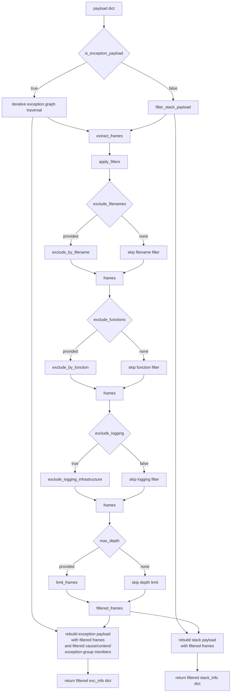
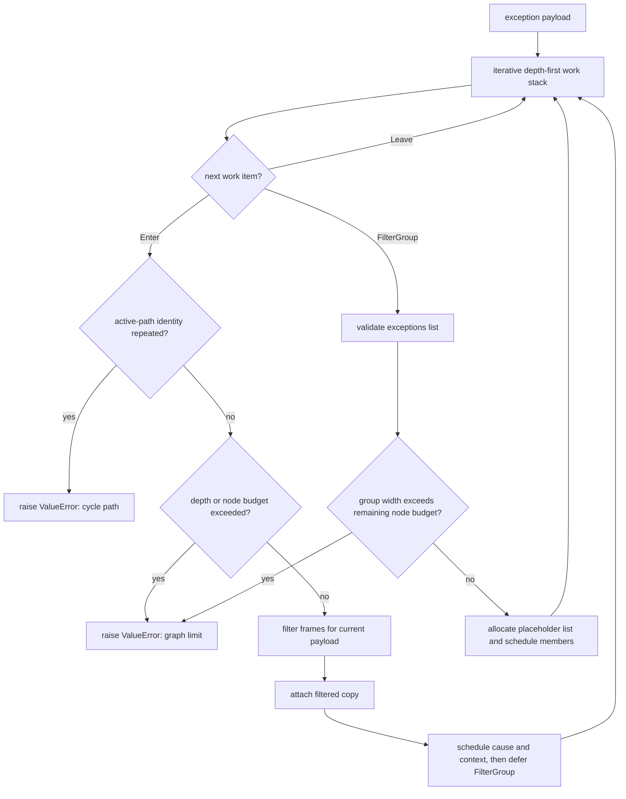
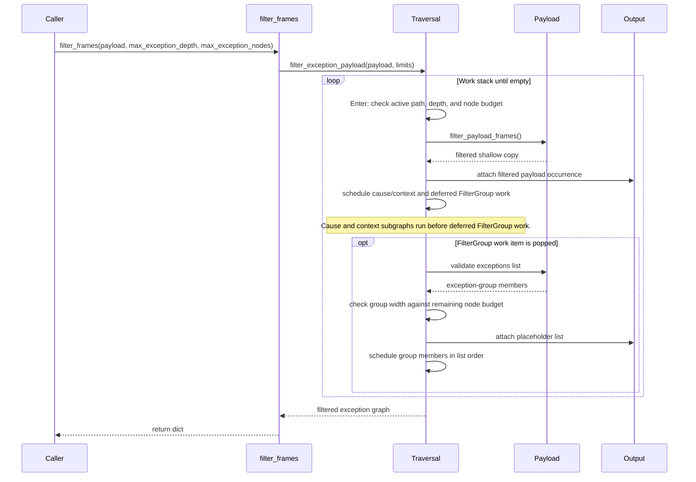

# Frame filtering API design

This document describes the frame filtering API for `exc_info` and `stack_info`
payloads in femtologging.

## Overview

The frame filtering API allows callers and formatters to exclude unwanted stack
frames from exception and stack trace payloads. Common use cases include:

- Removing logging infrastructure frames that add noise to stack traces
- Limiting stack depth for readability
- Excluding specific modules or functions from output

## Filter flow

The following diagram shows the flow of the Python `filter_frames()` function,
which applies each configured filter in sequence to produce a filtered payload:



*Figure 1: Filter flow for the `filter_frames()` function. The payload is first
classified as exception or stack type, then filters are applied conditionally
in sequence (exclusion filters before depth limiting). Exception payloads are
rebuilt through an iterative depth-first walk of cause/context/group edges,
while stack payloads are rebuilt with the filtered frames directly.*

## Design decisions

### Payload-level filtering

The filtering operates on payload dictionaries rather than modifying records
in-place. This approach:

- Aligns with the current design where `capture_*` functions return full frames
- Allows different formatters and handlers to filter differently
- Maintains testability and composability
- Keeps worker threads Global Interpreter Lock (GIL)-free (filtering operates
  on Rust-owned data)

### Filter order

Exclusion filters are applied before depth limiting. This ensures that:

1. Unwanted frames are removed first
2. The depth limit applies to the remaining useful frames
3. Users get the expected number of relevant frames

## Exception-graph traversal limits and malformed input

The Python binding traverses exception payloads with an explicit `Enter`,
`FilterGroup`, and `Leave` work stack. It visits `cause`, then `context`, then
`exceptions[i]` in list order. This keeps native stack use independent of
exception-chain depth while preserving the established edge order.

### Exception-graph traversal flow



*Figure 2: Enter work checks each payload for an active-path cycle and depth or
node-budget overflow before filtering and attaching its copy. Deferred
FilterGroup work later validates the exception list and its width before
allocating the output list and scheduling members.*

### Python binding sequence



*Figure 3: Each Enter work item checks cycle, depth, and node limits before
filtering and attaching a payload copy. Cause and context subgraphs run before
deferred FilterGroup work checks the exception-list width, allocates its output
list, and schedules group members.*

Cycle detection compares Python dictionary identity on the active ancestor
path. A repeated dictionary on that path is a cycle and raises
`ValueError("exception payload graph contains a cycle at <path>")`; paths start
at `$`, for example `$.cause.exceptions[2]`. The active-path check allows a
shared acyclic dictionary to appear on multiple edges. Each occurrence is
copied and counted independently, so shared subgraphs cannot expand work
without consuming the node budget.

The root payload has exception depth `0`. The default
`max_exception_depth=1000` permits edges through depth 1000; a child beyond
that depth raises
`ValueError("exception payload graph exceeds max_exception_depth=<limit>")`.
The root-inclusive default `max_exception_nodes=10000` bounds total payload
occurrences, including exception-group width and repeated shared subgraphs.
Before allocating an output list for an exception group, the binding checks
that its complete width fits the remaining node budget. Exceeding the budget
raises
`ValueError("exception payload graph exceeds max_exception_nodes=<limit>")`. An
exception root with `max_exception_nodes=0` raises
`ValueError("max_exception_nodes=0 must be greater than zero")`.

The frame-list `max_depth` keeps its existing meaning: it limits retained
frames separately within each payload and does not limit exception-graph
traversal. Graph limits are ignored for stack payloads.

Malformed `frames` values retain their `TypeError` contract, including
`'frames' must be a list` and `each frame must be a dict`. Malformed exception
edges also raise `TypeError`: `'cause' must be a dict`,
`'context' must be a dict`, `'exceptions' must be a list`, or
`each exception must be a dict`. Negative or oversized integer limits raise
`OverflowError` when PyO3 converts them to `usize`.

## Logging infrastructure patterns

Default patterns for `exclude_logging=True`:

- `"femtologging"` — this library
- `"_femtologging_rs"` — Rust extension
- `"logging/__init__"` — standard library logging
- `"logging/config"` — logging configuration
- `"<frozen importlib"` — import machinery

## API summary

### Rust API

Methods on `StackTracePayload`:

- `filter()` — filter frames using a predicate
- `limit()` — keep at most N frames
- `exclude_filenames()` — exclude by filename patterns
- `exclude_functions()` — exclude by function patterns
- `exclude_logging_infrastructure()` — exclude common logging frames

Methods on `ExceptionPayload`:

- `filter_frames()` — recursive filtering (handles cause, context, groups)
- `limit_frames()` — recursive depth limiting
- `exclude_filenames()` — recursive filename exclusion
- `exclude_functions()` — recursive function exclusion
- `exclude_logging_infrastructure()` — recursive infrastructure exclusion

Helper functions in `frame_filter` module:

- `filter_frames()` — predicate-based filtering
- `limit_frames()` — depth limiting
- `exclude_by_filename()` — filename pattern matching
- `exclude_by_function()` — function name pattern matching
- `exclude_logging_infrastructure()` — infrastructure frame removal

### Python API

```python
filter_frames(
    payload: dict,
    *,
    exclude_filenames: list[str] | None = None,
    exclude_functions: list[str] | None = None,
    max_depth: int | None = None,
    exclude_logging: bool = False,
    max_exception_depth: int = 1000,
    max_exception_nodes: int = 10_000,
) -> dict
```

Returns a new payload dictionary with frames filtered according to the
specified parameters. `max_depth` limits frames per payload; the two
`max_exception_*` parameters independently bound traversal of exception roots.

```python
get_logging_infrastructure_patterns() -> list[str]
```

Returns the default patterns used to identify logging infrastructure frames.

## Usage example

```python
from femtologging import filter_frames


class MyHandler:
    def handle_record(self, record: dict) -> None:
        if exc := record.get("exc_info"):
            filtered = filter_frames(
                exc,
                exclude_logging=True,
                max_depth=10,
            )
            # Use filtered payload for output
```
