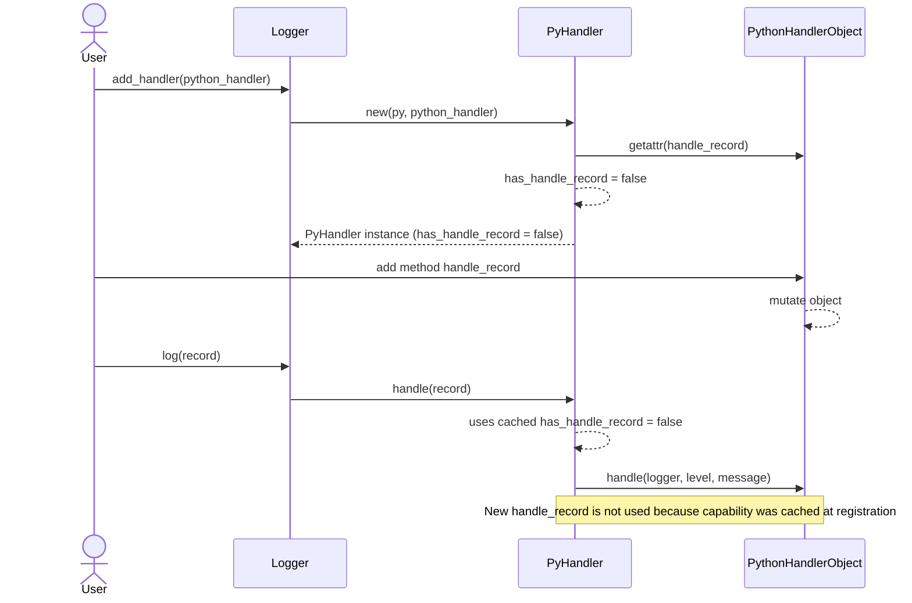

# Femtologging user guide

Femtologging is an asynchronous logging runtime for Python applications that
delegates IO and record fan-out to Rust worker threads. This guide covers the
features that are currently implemented, how they differ from the CPython
`logging` module, and the practical caveats you need to keep in mind when
building production systems on top of femtologging.

## Quick start

After the first release is published, install the package from PyPI:

```bash
pip install femtologging
```

The first release has not yet been published. Until then, install from the
repository with `pip install .`. Maturin is the PEP 517 backend that compiles
the Rust extension, so `rustc` and `cargo` must be available on `PATH`. This
source build uses the production feature set and excludes the test-only
`test-util` feature.

Then emit a log record:

```python
from femtologging import FemtoStreamHandler, get_logger

logger = get_logger("demo.app")
logger.add_handler(FemtoStreamHandler.stderr())

logger.log("INFO", "hello from femtologging")
```

Handlers run in background threads, so remember to flush or close them before
your process exits.

## Architectural overview

- Loggers share a small, fixed pool of dispatch shards, one worker thread
  each, sized from the machine's available parallelism (one to four). A logger
  is assigned a shard rather than owning a thread, so the threads a process
  spends on logging follow the machine rather than the number of loggers it has
  created. Calls to `logger.log()` enqueue a record on the logger's shard and
  return immediately.
- Each shard's queue holds 1,024 records multiplied by the number of shards in
  the pool, so a four-shard pool gives each shard a depth of 4,096. Each logger
  may hold at most half of its shard's depth, never more than 1,024, so the
  pool grows with the machine while any one logger's share does not. The
  per-logger limit stops one logger from consuming every permit, so an
  over-active logger cannot crowd the loggers sharing its shard out of the
  queue. It does not stop a handler that never returns from blocking the
  shard's single worker while holding its permits: the other loggers on that
  shard can then exhaust their own allowances and drop records even though the
  shard has permits left. Separate shards, and the machine-derived shard count,
  are what keep one stuck handler from stopping the whole process.
- Handlers (`FemtoStreamHandler`, `FemtoFileHandler`,
  `FemtoRotatingFileHandler`, and `FemtoSocketHandler`) also own dedicated
  queues and worker threads so file IO, stdout/stderr writes, and socket
  operations run on worker threads. A `handle()` call enqueues work when space
  is available; behaviour on a full queue depends on the handler. For file
  handlers, direct `handle()` calls using `"block"` or `"timeout:N"` wait in
  the calling thread. `flush()` and `close()` may also wait for worker
  completion. See
  [Concurrency and the GIL for file handlers](#concurrency-and-the-gil-for-file-handlers).
- When any queue is full under the default policy, the record is dropped. Each
  component emits rate-limited warnings and maintains drop counters
  (`FemtoLogger.get_dropped()` and handler-specific warnings) so you can
  monitor pressure. A file handler whose policy is `"block"` waits for room
  instead of dropping; with `"timeout:N"` it waits for room only until its
  deadline, then drops the record.
- Record metadata tracks the logger name, level, message text, timestamps,
  thread identity, optional structured exception (`exc_info`) and call stack
  (`stack_info`) payloads, and validated inline structured fields (`extra`).
  The Python API does not expose other rich `LogRecord` attributes such as the
  calling module.

## Working with loggers

### Creating and naming loggers

- Use `get_logger(name)` to obtain a singleton `FemtoLogger`. Names must not be
  empty, start or end with `.`, or contain consecutive dots.
- Names are limited to 255 bytes and 32 dot-separated segments, and may not
  contain control characters. That covers the ASCII controls (`0x00`–`0x1F` and
  `0x7F`), the C1 controls (`U+0080`–`U+009F`), and `U+2028`/`U+2029`, the
  Unicode line and paragraph separators. A name that breaks any of these is
  rejected with `ValueError`. The rule matters even though a logger never
  writes its own name: the name is rendered into every formatted record, and
  Python's `str.splitlines()` splits on all of these characters, not only on
  `\n`, so a name carrying any of them could split one record into two lines of
  output. This validation applies to names passed through the logger API. A
  direct `FemtoFileHandler.handle(logger, level, message)` call takes the
  logger string as given and does not validate it, so pass a name that already
  satisfies the rule when its framing matters.
- Name loggers after stable components — a module, subsystem, or service — not
  after the data flowing through them. A registry that maps one logger per
  request, tenant, user, or plug-in identifier grows for the life of the
  process, which is a memory leak a caller controls by accident:

  ```python
  # Do not do this: one logger per request, retained forever.
  logger = get_logger(f"requests.{request_id}")
  logger.info("handled")

  # Do this instead: a fixed name, with the identifier as a field.
  logger = get_logger("requests")
  logger.info("handled", extra={"request_id": request_id})
  ```

- The registry holds at most 10,000 named loggers and never evicts one, so a
  logger keeps its handlers, level, and drop counters for the life of the
  process. Once the cap is reached, a request for a name that does not yet
  exist is refused with `RuntimeError`. Names already registered keep working,
  and the `"root"` logger is always available and does not count against the
  cap.
- Logger parents are derived from dotted names. `get_logger("api.v1")` creates
  a parent `api` logger that ultimately propagates to `root`.
- Call `logger.set_propagate(False)` to stop parent propagation. The default is
  to bubble records to ancestors, just like the stdlib.
- `reset_manager()` clears all registered loggers. It is intended for tests and
  is not thread-safe.

Loggers share a small fixed pool of dispatch threads rather than each owning
one, so the number of threads the logging system uses depends on the machine
rather than on how many loggers exist. A record is dropped instead of blocking
the caller when either bound is reached: when the logger has spent its own
in-flight allowance, or when its shard has no free slot. Either condition is
enough on its own, so a logger at its allowance drops records while its shard
still has room, and a shard with every permit taken drops records from loggers
that are below theirs. The drop is counted, and `logger.get_dropped()` reports
it.

### Emitting records

- `logger.log(level, message)` accepts the case-insensitive names `"TRACE"`,
  `"DEBUG"`, `"INFO"`, `"WARN"`, `"WARNING"`, `"ERROR"`, and `"CRITICAL"`.
- The method returns the formatted string when the record passes level checks
  (default format is `"{logger} [LEVEL] message"`), or `None` when the logger
  is disabled or the record is filtered out. This differs from
  `logging.Logger.log()`, which always returns `None`.
- Convenience methods `logger.debug(message)`, `logger.info(message)`,
  `logger.warning(message)`, `logger.error(message)`,
  `logger.critical(message)`, and `logger.exception(message)` are available.
  Each accepts a pre-formatted `message` string plus optional `exc_info` and
  `stack_info` keyword arguments, identical to `log()`. Unlike the stdlib,
  `*args` / `**kwargs` lazy formatting is not supported — build the final
  message string before calling these methods. `exception()` behaves like
  `error()` but defaults `exc_info` to `True`.
- `log()` and the `debug`, `info`, `warning`, `error`, and `critical`
  convenience methods accept the keyword-only argument `extra` for validated
  inline structured fields. `extra` must be a mapping with string keys and
  `str`, `int`, `float`, `bool`, or `None` values. Reserved names that collide
  with built-in record fields raise `ValueError`; see
  [Scoped structured context](#scoped-structured-context) for the reserved sets.
- `log()` accepts the keyword-only arguments `exc_info` and `stack_info` for
  capturing exception tracebacks and call stacks alongside the log message.
  `exc_info` accepts any of the following forms:
  - `True` — capture the current exception via `sys.exc_info()`.
  - An exception instance — capture that exception's traceback.
  - A `(type, value, traceback)` 3-tuple — use directly.
  - `False` or `None` (default) — no capture.

  `stack_info` is a boolean (`False` by default). When `True`, the current call
  stack is appended to the record. Both payloads are rendered by the default
  formatter and are available as structured data to `handle_record` handlers.

  ```python
  try:
      db.execute(query)
  except DatabaseError:
      logger.log("ERROR", "query failed", exc_info=True)

  # Capture just the call stack (no exception needed):
  logger.log("DEBUG", "checkpoint reached", stack_info=True)
  ```

- `logger.isEnabledFor(level)` returns `True` when the logger would process a
  record at the given level. A disabled logger returns `False` for every level.
  Use it for expensive message construction that should be skipped when the
  level is filtered out.
- `getLogger(name)` is an alias for `get_logger(name)`, provided for drop-in
  compatibility with code written against `logging.getLogger`.
- The default formatter keeps the message field on the record's first physical
  line. It escapes the line separators that Python's `str.splitlines()`
  recognizes in the message — LF, CR, VT, FF, U+001C, U+001D, U+001E, NEL,
  U+2028, and U+2029 — using their `char::escape_debug` forms, such as `\n` and
  `\u{2028}`. Every other character, including a backslash and a horizontal
  tab, is unchanged. A literal `\n` in the message therefore looks the same as
  an escaped LF, so the transformation cannot be reversed. Stack and exception
  diagnostics are not escaped and keep their own multiline structure; that
  includes the exception message, so a separator inside an exception message
  can still add a forged line. Only the default formatter escapes:
  percent-style and Python callable formatters, and structured `handle_record`
  handlers, receive the raw message. Escaping can lengthen a record, so
  size-based rotation counts the escaped bytes and may roll over sooner than
  the unescaped message length suggests.
- There is no lazy formatting. Build the final message string before calling
  `log()`.

### Flushing records

`logger.flush_handlers()` waits for records already queued by that logger to
reach its handlers, then flushes each attached handler. The Python wrapper
releases the GIL while it waits, so Python handlers can run. For a native
handler such as `FemtoFileHandler`, the wrapper forwards the flush to the
handler's own `flush()`, so buffered records reach disk even though the handler
exposes no Python `flush` method. For any other handler object, the wrapper
calls its `flush()` when it defines one and treats a missing or non-callable
`flush` as success. A `flush()` that returns `None` — as
`logging.Handler.flush()` does — counts as success, and any other falsy return
value counts as failure. An exception, or an error other than a missing or
non-callable `flush` attribute, also counts as failure. One two-second deadline
covers the whole barrier — resolving dispatch state, enqueueing the marker,
waiting for its acknowledgement, and flushing every attached handler. A
synchronous handler callback can overrun its own wait, but the caller does not
get a separate budget for handler flushing. The method returns `True` when the
worker acknowledges the marker in time and every handler flush succeeds; it
returns `False` if the marker cannot be enqueued or acknowledged in time, or
any handler flush fails. A failing handler does not stop the remaining handlers
from being flushed.

<!-- tested-example: flush-handlers-usage -->
```python
import femtologging

logger = femtologging.get_logger("service")
# A large flush interval keeps the record buffered until an explicit flush.
handler = femtologging.FemtoFileHandler("service.log", flush_interval=10_000)
logger.add_handler(handler)

try:
    logger.info("shutting down")
    if not logger.flush_handlers():
        raise RuntimeError("logger handlers did not flush")

    # The record reached disk while the handler was still open, so this
    # proves logger.flush_handlers() flushed it rather than handler.close().
    with open("service.log", encoding="utf-8") as log_file:
        if "shutting down" not in log_file.read():
            raise RuntimeError("flush did not write the buffered record")
finally:
    logger.remove_handler(handler)
    handler.close()
```

### Exception schema versioning

Structured `exc_info` and `stack_info` payloads carry a `schema_version` field.
This allows the payload schema to evolve without silent breakage.

- `EXCEPTION_SCHEMA_VERSION` is the current version exposed by the Python API.
- Rust consumers accept versions in the inclusive range
  `MIN_EXCEPTION_SCHEMA_VERSION..=EXCEPTION_SCHEMA_VERSION`.
- Backward compatibility is guaranteed within that range. Missing optional
  fields default safely during deserialization.
- Forward compatibility is not guaranteed. A payload from a newer producer may
  deserialize, but explicit validation is required before processing.

Validation is recursive. Each `cause`, `context`, and exception-group member is
an independently versioned payload, so `validate_version()` checks the root
payload and every payload nested beneath it. The walk is depth-first in
pre-order: the payload itself, then its `cause`, its `context`, and its
exception-group members in index order. The first unsupported version reached
is the one reported.

A mismatch below the root is reported as `SchemaVersionError::Nested`, which
carries a dot-separated path to the failing payload, such as
`cause.exceptions[3].context`. The root payload is at depth 0, and each child
edge adds one. The walk stops at `MAX_EXCEPTION_PAYLOAD_DEPTH` (1,000, matching
the frame filter's default `max_exception_depth`) and at
`MAX_EXCEPTION_PAYLOAD_NODES` (10,000, matching its default
`max_exception_nodes`). Exceeding either bound reports `TreeTooDeep` or
`TreeTooLarge`. These limits bound validation work; they are not parsing
limits, so a payload tree that deserializes can still be rejected by either
bound.

Rust-side validation returns these variants from `SchemaVersionError`:

- `VersionTooNew { found, max_supported }`
- `VersionTooOld { found, min_supported }`
- `Nested { path, source }`
- `TreeTooDeep { path, max_depth }`
- `TreeTooLarge { max_nodes }`

`SchemaVersionError` is `#[non_exhaustive]`, so matching it requires a wildcard
arm. This breaks downstream code that matched the original two variants
exhaustively; the [v0.2.0 migration guide](v0-2-0-migration-guide.md) records
the migration. Use these variants to choose explicit behaviour when versions
mismatch:

<!-- tested-example: process-payload-schema-versioning -->
```rust
use _femtologging_rs::{
    ExceptionPayload, SchemaVersionError, SchemaVersioned,
};

/// Parse a payload and reject schema versions outside the supported range.
fn process_payload(json: &str) -> Result<(), Box<dyn std::error::Error>> {
    let payload: ExceptionPayload = serde_json::from_str(json)?;
    match payload.validate_version() {
        Ok(()) => {
            // Normal processing path.
            Ok(())
        }
        Err(SchemaVersionError::VersionTooNew {
            found,
            max_supported,
        }) => {
            // Reject too-new payloads explicitly.
            eprintln!(
                "payload schema {} is newer than supported {}",
                found, max_supported
            );
            Err(SchemaVersionError::VersionTooNew {
                found,
                max_supported,
            }
            .into())
        }
        Err(SchemaVersionError::VersionTooOld {
            found,
            min_supported,
        }) => {
            // Reject unsupported historical payloads explicitly.
            eprintln!(
                "payload schema {} is older than minimum {}",
                found, min_supported
            );
            Err(SchemaVersionError::VersionTooOld {
                found,
                min_supported,
            }
            .into())
        }
        Err(SchemaVersionError::Nested { path, source }) => {
            // Reject a nested payload whose own version is unsupported.
            eprintln!("nested payload at {path} failed validation: {source}");
            Err(SchemaVersionError::Nested { path, source }.into())
        }
        Err(SchemaVersionError::TreeTooDeep { path, max_depth }) => {
            // Reject payload trees deeper than validation traverses.
            eprintln!(
                "payload tree is too deep at {path}; maximum depth is {max_depth}"
            );
            Err(SchemaVersionError::TreeTooDeep { path, max_depth }.into())
        }
        Err(SchemaVersionError::TreeTooLarge { max_nodes }) => {
            // Reject payload trees larger than validation traverses.
            eprintln!("payload tree exceeds {max_nodes} nodes");
            Err(SchemaVersionError::TreeTooLarge { max_nodes }.into())
        }
        Err(other) => {
            // SchemaVersionError is non-exhaustive; propagate unknown failures.
            eprintln!("payload schema validation failed: {other}");
            Err(other.into())
        }
    }
}
```

Malformed JSON propagates as `serde_json::Error` inside the boxed error, and
version validation runs only after a successful parse.

When consuming payloads in Python from external sources, each nested `cause`,
`context`, and exception-group member carries its own `schema_version`. Compare
every one of them with `femtologging.EXCEPTION_SCHEMA_VERSION`, not only the
root, and apply the same policy: reject too-old payloads, and explicitly
degrade or reject too-new payloads.

Increment the schema version only for breaking changes (required field
additions, removals, renamed fields, or semantic/type changes). Adding optional
fields with safe defaults does not require a version bump.

### Managing handlers and custom sinks

- The built-in handlers implement the Rust-side `FemtoHandlerTrait`. Python
  handlers can be attached by supplying any object that exposes a callable
  `handle(logger_name: str, level: str, message: str)` method.
- Python handlers run inside a shared dispatch worker, not the calling thread.
  Ensure they are thread-safe and fast: a slow handler delays every logger
  assigned to the same shard, not only the logger it is attached to. (Loggers
  are spread across the shards, so the blast radius is the shard rather than
  the process.) Records that arrive while a shard is at its bound are dropped
  and counted.
- `logger.add_handler(handler)` accepts either a Rust-backed handler or a Python
  handler as described above. Use `logger.remove_handler(handler)` or
  `logger.clear_handlers()` to detach them. Removals only affect records that
  are enqueued after the call because previously queued items already captured
  their handler list.
- Use `logger.get_dropped()` to inspect records refused at dispatch admission:
  the logger's allowance or shard permits were exhausted, the shard queue was
  full or gone, or an inherited logger could not start the process-local pool
  after `fork`.
- Use `logger.get_context_capture_failures()` to inspect failed producer-context
  snapshots. This counter is separate from `get_dropped()` and does not include
  dispatch-admission refusals.
- Use `logger.get_flush_diagnostics()` to poll fixed-cardinality flush-barrier
  counters for attempts, confirmations, failure stages and elapsed-time
  buckets. The keys remain stable and include no logger names, paths, messages
  or payloads. Values are a best-effort snapshot read from relaxed atomics, so
  concurrent updates may appear at different instants. Exporting these values
  through a shared metrics adapter remains the application's responsibility.
- Use `logger.get_context_dropped()` to inspect records discarded when Rust
  scoped context or explicit Rust key-values fail validation. This counter is
  separate from queue-capacity drops.
- `logger.disabled` is a read-only property reporting whether a configuration
  with `disable_existing_loggers=True` disabled the logger. A disabled logger
  rejects its own records before the level check, filters, formatter, dispatch,
  or propagation, so `log()` returns `None` and `isEnabledFor()` returns
  `False` for every level. A later configuration that names the logger
  re-enables it.
- Use `logger.get_disabled_drops()` to inspect records refused because a
  configuration with `disable_existing_loggers=True` disabled the logger. The
  record never reaches the level check, filters, formatter, or dispatch, so
  this counter is separate from `get_dropped()`. A later configuration that
  names the logger re-enables it and stops the counter rising.

Logger destruction reports a pending count that the warning interval is still
holding back. At that point, the dispatch-admission drops counted by
`get_dropped()` use `FemtoLogger: dropped {count} records; reported by flush`,
and the context-capture failures counted by `get_context_capture_failures()` use
`FemtoLogger: dropped {count} records after context capture failed`. Both
figures are cumulative since the last report, so a suppressed interval's drops
are carried into the next one. Destruction reports whatever is still pending at
that point; a count whose interval elapsed first may already have been reported
by a due warning, so the message does not mean every drop since the last report
is still outstanding. A logger flush adds no report of its own: the barrier is
deadline-bound, so a blocking sink must not be able to push `flush_handlers()`
past its timeout, and these counts wait for destruction. (An open handler's own
pending count still travels on the barrier's marker to that handler's worker.)

### Flushing logger handlers

`logger.flush_handlers()` queues a marker behind records the logger has already
accepted when handlers are attached, then snapshots the handlers before
allowing the worker to run their flush callbacks. With no handlers but records
in flight, it queues a shard-wide drain marker instead; that marker sits behind
work other loggers have already queued on the same shard, so that work can
delay the flush. Handler additions and removals completed before that snapshot
are reflected in this barrier; a handler removed afterwards remains alive in
the snapshot until the worker releases it, and later additions participate in
the next barrier. One two-second deadline covers dispatch resolution, marker
insertion, handler-list locking, worker acknowledgement and every handler
flush. Built-in handlers keep their own shorter flush limits, whether fixed or
configurable: the file handlers stop waiting after a fixed second, while the
stream handler has a configurable `flush_timeout`. The Python method releases
the GIL while waiting so Python handlers can run.

The method returns `False` when a stage is not confirmed by the deadline, the
worker has exited, or a handler reports failure or lacks deadline support. A
user-defined Python handler is asked to flush itself: the barrier calls its
callable `flush` method. A handler with no callable `flush` has nothing to
drain, so it is confirmed once the record reaches it; one whose `flush` raises
or returns a falsy value other than `None` reports failure, and its exception
text is never printed. `None` counts as success, as Python's flush protocol
reports success that way. The timeout bounds the caller's Rust barrier wait; it
cannot stop a synchronous handler callback that is still running. In normal
builds, logger drop waits for its own in-flight records only, up to the bounded
drain timeout, and does not join the shared process-wide worker. A callback
that violates its deadline may keep that worker occupied after the flush returns
`False`. PyO3 must reacquire the interpreter before returning to Python, so
interpreter contention can delay the Python return beyond the barrier deadline.

Custom Rust handlers that should participate must implement the deadline-aware
`FemtoHandlerTrait::flush_until(context)` contract. Its default fails closed
without invoking legacy synchronous `flush()` code. See the
[Rust handler port guide](formatters-and-handlers-rust-port.md#femtohandler-trait-and-implementations)
for the compatibility rules.

## Built-in handlers

### FemtoStreamHandler

- `FemtoStreamHandler.stderr()` (default) and `.stdout()` log to the respective
  standard streams. Calls return immediately; the handler thread flushes the
  underlying `io::Write`.
- `handler.flush()` waits (up to one second by default) for the worker to flush
  buffered writes and returns `True` only when the worker acknowledges
  `Ok(())`. One deadline, set by the flush timeout, bounds the whole call:
  queueing the flush command and waiting for the acknowledgement share it. It
  returns `False` if the underlying I/O flush fails, the handler has already
  been closed, the worker channel has been dropped, or the deadline expires.
- `handler.close()` stops accepting records and waits, up to the handler's
  flush timeout, for the worker to process the records already queued; call it
  before process exit. Both `flush()` and `close()` release the GIL while they
  wait so a Python callable formatter can run to completion on the worker
  thread during either call. `close()` returns no status, so a caller cannot
  tell from the return value whether the worker finished.

  The wait is bounded by the handler's flush timeout, which
  `StreamHandlerBuilder.with_flush_after_ms()` sets. If the timeout expires,
  `close()` returns without the worker having finished; the worker keeps
  processing its queue and can still write to the stream after `close()`
  returns. A successful `close()` returns once the worker raises its completion
  signal, without joining the worker thread: joining would also wait for
  thread-local destructors, which user code can make block, so the worker is
  detached and reclaimed by the operating system when it exits. Completion does
  not guarantee delivery, because a worker panic still signals completion with
  records queued, and write errors are logged rather than reported to the
  caller.
- A dropped record is reported as
  `FemtoStreamHandler: {count} log records dropped since the last report`. The
  count is cumulative, so a suppressed warning interval carries its drops into
  the next report. An open handler's `flush()` carries a pending count on its
  flush marker, which the worker reports before acknowledging; if the marker
  never enters the queue the count stays pending. `close()` and destruction
  report a pending count directly because no later warning will come: the
  former before it waits for the worker, the latter before it closes. That
  report runs before the close wait starts, so a blocking `log` sink can delay
  `close()` past the flush timeout, and the Python `close()` makes it while
  still holding the GIL. A flush on an already closed handler reports nothing
  and returns `False`.
- To tune capacity, flush timeout, or formatters use `StreamHandlerBuilder`. It
  provides `.with_capacity(n)`, `.with_flush_after_ms(ms)`, and
  `.with_formatter(callable_or_id_or_builder)` fluent methods before calling
  `.build()`.

A direct `flush()` shares one configured `flush_timeout` between queue
admission and the acknowledgement, so admission that spends part of that budget
leaves less of it for the worker's answer. Under load, `flush()` can therefore
return `False` even though the handler is healthy: admission may spend the
budget while the queue is full, or the worker may not acknowledge what is left.
The logger's `flush_handlers()` does not change this: it gives the handler the
barrier's deadline, and the handler still caps its own wait at its configured
`flush_timeout`.

### FemtoFileHandler

- Constructor signature:
  `FemtoFileHandler(path, capacity=1024, flush_interval=1, policy="drop")`. The
  flush interval counts *records*, not seconds.
- `policy` controls queue overflow handling:
  - `"drop"` (default) discards records and raises `RuntimeError`.
  - `"block"` blocks the caller until the worker makes room.
  - `"timeout:N"` blocks for `N` milliseconds before giving up.
- Use `handler.flush()` and `handler.close()` to move queued records to disk,
  and check what `flush()` reports. `flush()` returns `True` only when the
  worker acknowledged the flush within its one-second timeout; a `False` result
  means the records were not confirmed written. `True` confirms the flush
  operation itself, not that every queued record was written or durably stored:
  an individual record whose write failed is logged and skipped, and the worker
  can still acknowledge a later flush. Always close the handler when the
  application shuts down. `close()` is idempotent and safe to call multiple
  times; only the first call performs shutdown work, and every call waits on
  the same completion signal. That wait is bounded to one second: if the worker
  does not signal completion within that second, `close()` logs a warning and
  returns while the worker may still be running, so a timed-out close is not
  confirmation that queued records have been written, and a second `close()`
  that also times out does not confirm completion either. Prefer calling
  `close()` explicitly: the destructor performs the same shutdown, but it runs
  with the interpreter lock held, so it cannot offer the GIL release described
  below.

  On CPython 3.12 and earlier, a worker that is still running when the
  interpreter starts finalizing can abort the whole process instead of failing
  quietly. A worker that runs a Python-callable formatter attaches to the
  interpreter to call it, and PyO3 only guards that attach during finalization
  on CPython 3.13 and later. A timed-out `close()`, including a repeated one,
  therefore leaves that window open. Restore worker progress first — do not
  park the worker and exit — then confirm completion before the process ends by
  reading `wait_diagnostics()`. Those counters are cumulative for the handler's
  lifetime: `close_completed`, `close_panicked` and `close_unknown` each count
  a closer that reached a verdict on the worker's exit, and `close_timed_out`
  counts the closers that returned without one. An earlier timeout therefore
  stays counted after a later close succeeds, so confirm a retry by snapshotting
  `wait_diagnostics()` immediately before it and again after it returns, and
  check that one of the verdict counters increased. A non-zero
  `close_timed_out` only records the earlier attempt; it does not mean the
  retry also failed.
- In Rust, `close()` takes `&self` and may be called concurrently on a shared
  handler, including while another thread flushes it. Every closer observes the
  same completion signal, and a closer that arrives after the worker has
  stopped returns immediately. Each wait is bounded to one second: a worker
  that does not signal completion in that window is reported, and the call
  returns without joining it.
- `handler.wait_diagnostics()` returns counters for the Python-facing waits: one
  entry per outcome across `handle()`, `flush()`, and `close()`, plus
  `total_wait_micros`, `max_wait_micros`, and `waits_in_flight`. The last of
  these is a gauge rather than a counter: it is non-zero while any thread is
  still inside a wait, so a reader can tell an idle handler from one whose
  caller is parked, and can see a `close()` that has not yet settled the
  worker. The key set is fixed and never includes logger names, paths,
  messages, or raw timeout values. Reading the diagnostics is itself cheap and
  records nothing, so a monitoring loop cannot inflate the numbers it reports.
  With the `tracing-compat` feature the same outcomes are emitted as
  `femtologging::internal` trace events; see
  [Handler wait diagnostics](developers-guide.md#handler-wait-diagnostics).
- `FileHandlerBuilder` mirrors these options and also exposes
  `.with_overflow_policy(OverflowPolicy.drop()/block()/timeout(ms))` and
  `.with_formatter(…)`. Pass a callable, a `FormatterBuilder`, or a named
  formatter registered on `ConfigBuilder` to customize output.

#### Concurrency and the GIL for file handlers

Explicit Python calls to `handle()`, `flush()`, and `close()` release the
interpreter lock (`GIL`) for the whole of any wait on the channel, on the
worker's flush acknowledgement, or on the worker's shutdown. Another Python
thread therefore keeps running while one thread is parked on back pressure, and
slow file IO can no longer stall every thread in the interpreter. The rotating
and timed-rotating handlers are built on the same worker and inherit this
contract; see [FemtoRotatingFileHandler](#femtorotatingfilehandler) and
[FemtoTimedRotatingFileHandler](#femtotimedrotatingfilehandler).

Two consequences follow from that release, and both concern `"block"`:

- A `"block"` wait is **unbounded**. It ends when the worker makes room or when
  the channel closes, and nothing else ends it. If the worker has stopped
  draining — a stalled filesystem, a full disk, a formatting callable that
  never returns — the calling thread waits for as long as that lasts.
- `close()` does **not** cancel a `handle()` call that is already blocked.
  `close()` takes the shutdown state and waits on the shared completion signal,
  but the blocked `handle()` holds its own clone of the sender and stays
  blocked until the worker makes room. Restore worker progress and let the
  blocked call finish before calling `close()`.

Two states follow, and they describe different points in the shutdown:

- While a `handle()` or `flush()` call is waiting — blocked on queue capacity
  or waiting for a flush acknowledgement — it holds a shared borrow of the
  handler and, for `handle()`, its own clone of the sender. Another `handle()`
  or `flush()` call may take its own shared borrow and start, although it may
  then wait on the same queue. A `close()` takes the shutdown state and waits
  on the shared completion signal, so it does not raise; it returns once the
  blocked call is accepted and the worker stops, or after its own one-second
  bound.
- Once a `close()` has taken the shutdown state, concurrent `handle()` calls
  raise `RuntimeError`, `flush()` returns `False`, and a second `close()`
  shares the first one's completion wait rather than starting new shutdown work.
  `FemtoTimedRotatingFileHandler` reports the closed handler from `handle()` as
  `ValueError`, like its other handler errors. This keeps a worker formatter
  that re-enters the handler safe while shutdown is in progress.

Callers who need a wait that ends on its own must use `"timeout:N"`. They must
also handle the exception raised when the deadline expires and the record is
dropped. `FemtoFileHandler` and `FemtoRotatingFileHandler` raise `RuntimeError`;
`FemtoTimedRotatingFileHandler` currently maps the same enqueue failure to
`ValueError`.

Under the logger path there is no such choice to make: dispatch through
`logger.log()` waits in the logger's worker thread, not in the thread that
called `logger.log()`. The producer returns as soon as the logger's own queue
accepts the record.

### FemtoRotatingFileHandler

- Wraps `FemtoFileHandler` with size-based rotation. Instantiate via
  `FemtoRotatingFileHandler(path, options=HandlerOptions(…))`.
- `HandlerOptions` fields:
  - `capacity`, `flush_interval`, and `policy` mirror `FemtoFileHandler`.
  - `rotation=(max_bytes, backup_count)` enables rollover when *both* values
    are greater than zero. Set `(0, 0)` to disable rotation entirely.
- Rotation renames the active log file to `.1`, shifts older backups up to
  `backup_count`, and truncates the live file. If opening a fresh file fails
  the implementation falls back to appending to the existing file and logs the
  reason.
- `handler.close()` follows the same contract as `FemtoFileHandler`: it is
  idempotent, only the first call performs shutdown work, and concurrent close
  calls share one worker-completion wait rather than needing caller-side
  synchronization.
- `handle()`, `flush()`, and `close()` inherit the interpreter-lock contract
  described in
  [Concurrency and the GIL for file handlers](#concurrency-and-the-gil-for-file-handlers),
  including the unbounded `"block"` wait and its shutdown semantics.
- `wait_diagnostics()` reports the same bounded counters as
  `FemtoFileHandler`; trace events carry `handler_kind="rotating"` so the two
  handlers stay distinguishable.
- `RotatingFileHandlerBuilder` provides the same fluent API as the file builder
  plus `.with_max_bytes()` and `.with_backup_count()`.

### FemtoTimedRotatingFileHandler

- Wraps `FemtoFileHandler` with time-based rotation. Instantiate via
  `FemtoTimedRotatingFileHandler(path, options=TimedHandlerOptions(…))`.
- `TimedHandlerOptions` keeps the queue fields (`capacity`, `flush_interval`,
  `policy`) and adds `when`, `interval`, `backup_count`, `utc`, and optional
  `at_time`.
- Supported `when` values are `S`, `M`, `H`, `D`, `MIDNIGHT`, and `W0`-`W6`.
  `at_time` is only valid for daily, midnight, and weekday schedules.
- Rotation runs on the worker thread. `backup_count == 0` keeps all timestamped
  backups instead of disabling rotation.
- `handle()`, `flush()`, and `close()` inherit the interpreter-lock contract
  described in
  [Concurrency and the GIL for file handlers](#concurrency-and-the-gil-for-file-handlers),
  including the unbounded `"block"` wait and its shutdown semantics.
- `wait_diagnostics()` reports the same bounded counters as
  `FemtoFileHandler`; trace events carry `handler_kind="timed_rotating"` so the
  three worker-backed handlers stay distinguishable.
- `TimedRotatingFileHandlerBuilder` mirrors the direct handler surface with
  `.with_when()`, `.with_interval()`, `.with_backup_count()`, `.with_utc()`, and
  `.with_at_time()`.

### FemtoSocketHandler

- Socket handlers must be built via `SocketHandlerBuilder`. Typical usage:

```python
from femtologging import BackoffConfig, SocketHandlerBuilder

socket_handler = (
    SocketHandlerBuilder()
    .with_tcp("127.0.0.1", 9020)
    .with_capacity(2048)
    .with_connect_timeout_ms(5000)
    .with_write_timeout_ms(1000)
    .with_tls("logs.example.com", insecure=False)
    .with_backoff(
        BackoffConfig({
            "base_ms": 100,
            "cap_ms": 5000,
            "reset_after_ms": 30000,
            "deadline_ms": 120000,
        })
    )
    .build()
)
```

- Default transport is TCP to `localhost:9020`. Call `.with_unix_path()` to use
  Unix sockets on POSIX systems. TLS only works with TCP transports; attempting
  to combine TLS and Unix sockets raises `HandlerConfigError`.
- Records are serialized to MessagePack maps:
  `{logger, level, message, timestamp_ns, filename, line_number, module_path,
    thread_id, thread_name, key_values}` and framed with a 4-byte big-endian
  length prefix.
- The worker reconnects automatically using exponential backoff. Payloads that
  exceed the configured `max_frame_size` are dropped.
- `handler.flush()` forces the worker to flush the active socket, and returns
  `True` only when the worker acknowledges. One deadline of the handler's flush
  timeout covers both the wait for queue space and the acknowledgement, so a
  flush returns `False` once that single budget is spent rather than waiting a
  second full timeout for the worker to answer. It returns `False` when the
  handler is closed, the worker channel is gone, the connection fails to flush
  with an I/O error, the marker is discarded during shutdown, or the budget
  expires. An acknowledgement therefore has to report a successful flush to
  count, not merely arrive. Python `flush()` releases the GIL while it waits,
  so other Python threads keep running during a flush that blocks on a full
  queue or a slow collector.
- `handler.close()` waits for the worker for at most the handler's write
  timeout. During that window, each pending record gets at most one best-effort
  attempt, without retries. A worker that acknowledges the shutdown in time is
  joined. One that does not, typically because it is blocked writing to a
  collector that has stopped reading, is detached with a warning rather than
  joined past the deadline. Records still queued when the deadline passes are
  discarded, and the count is warned about. The same bound applies when the
  handler is dropped without an explicit `close()`, and the wait runs with the
  GIL released.
- One record is written in steps, and the remaining budget is recomputed
  between them. A frame larger than the socket send buffer therefore stops at
  the deadline with a warning that reports how many bytes were written, instead
  of spending one socket timeout per buffer-sized chunk. A partial frame leaves
  the collector with a truncated record, which is the same outcome as a record
  that arrived after the deadline: the connection is not reused afterwards.
- Two operations are outside the cooperative cancellation above, and a `close`
  against either one is answered by detaching the worker rather than joining
  it. A Unix domain socket connect that finds a full listener backlog blocks
  until a slot frees or the listener closes, and the standard library offers no
  timed or non-blocking constructor for it; the deadline is checked before the
  attempt, so no connect begins once it has passed, but an attempt already
  blocked is not interrupted. Hostname resolution for a TCP transport has the
  same limitation for the same reason. In both cases `close()` still returns
  inside its budget, and the detached worker leaves as soon as its blocking
  call returns or fails.
- Dropped records are reported as
  `FemtoSocketHandler dropped {count} records since the last report`, with
  `; triggering cause: {cause}` appended when a specific drop triggered the
  warning. The count is cumulative, so it can cover several suppressed
  intervals and earlier drops from other causes; only the cause that triggered
  this report is named. An open handler's `flush()` carries a pending count on
  its flush marker, which the worker reports before acknowledging alongside its
  own suppressed count; if the marker never enters the queue the count stays
  pending. `close()` and destruction report a pending count directly, because
  no later warning will come, and a flush on an already closed handler reports
  nothing and returns `False`. The close-time report runs before the bounded
  shutdown wait and is outside `flush_timeout` (the handler's write timeout),
  so a blocking log sink can delay `close()` past its budget.

### FemtoHTTPHandler

- HTTP handlers are built via `HTTPHandlerBuilder` and send one serialized
  record per request from a dedicated worker thread.
- Use `.with_endpoint(url, method="POST")` to configure the destination in a
  single call. Legacy `.with_url()` and `.with_method()` setters remain
  available for compatibility.
- Use `.with_auth({"token": "..."})` for bearer tokens or
  `.with_auth({"username": "...", "password": "..."})` for basic auth. Legacy
  `.with_basic_auth()` and `.with_bearer_token()` setters remain available for
  compatibility.
- `with_headers(...)`, `with_capacity(...)`, timeout setters, and
  `.with_json_format()` mirror the socket/file builder style.
  `HTTPHandlerBuilder` rejects an invalid header name, header value, or bearer
  token at build time with `HandlerConfigError`. The message never echoes a
  header value.
- The endpoint must be an absolute `http` or `https` URL. A malformed endpoint,
  another scheme, or an endpoint the transport cannot send is rejected with
  `HandlerConfigError` when the handler is built, instead of failing on every
  record. A path that needs percent-encoding is accepted and encoded on the
  wire, so `http://host/log ingest` reaches the collector as `/log%20ingest`.
- Certificates are validated against the WebPKI roots bundled with the
  extension, not the platform trust store. A private certificate authority is
  not supported, and there is no setting that weakens verification.
- `connect_timeout_ms` bounds connection establishment, including the TLS
  handshake. `write_timeout_ms` bounds the whole attempt, so it also caps the
  connect phase: a connection may wait for at most the smaller of the two.
- A redirect chain is followed for at most four redirects. A 301, 302 or 303 is
  re-requested as a GET, and a 307 or 308 only for a GET. `Authorization` and
  `Cookie` are never replayed at the redirect target. These redirects fail
  permanently: a 300 or any other status with no replay rule, a 307 or 308
  answering a POST, and a redirect whose `Location` is missing or not valid
  UTF-8. A fifth redirect is a transport failure, so the record follows the
  normal retry policy.
- A transport failure logs a fixed classification instead of the HTTP client's
  own error text, for example `transport error (invalid URL)`,
  `transport error (DNS lookup failed)`, or `transport error (invalid header)`.
  The classification never repeats the configured URL's userinfo or query
  values, a rejected header's value, or a redirect target, so credentials
  cannot reach the diagnostic output. The endpoint itself is omitted because
  each handler has exactly one configured URL.
- Authoritative fields (`name`, `levelname`, `msg`, `created`, `filename`,
  `lineno`, `module`, `thread`, and the optional `threadName`, `exc_info`, and
  `stack_info`) stay at the top level in both JSON and URL-encoded payloads.
  Legitimate custom structured fields are flat, string-valued top-level members
  alongside them.
- Reserved structured names are omitted from custom metadata in every HTTP
  format, so lower-trust metadata cannot replace an authoritative value even
  when a record is constructed without admission validation.
  `.with_record_fields([...])` selects built-in fields by name and projects
  permitted custom fields by their top-level name. A reserved name in that list
  selects only the built-in field, and unknown names are omitted.
- These builder and transport rules are new in v0.2.0. See
  [the migration guide](v0-2-0-migration-guide.md#http-handler-endpoint-validation-and-redirects)
  before upgrading an HTTP handler.
- `handler.close()` waits for the worker for at most the handler's write
  timeout. During that window, each pending record gets at most one best-effort
  attempt, without retries. A worker that acknowledges the shutdown in time is
  joined. One that does not, typically because a request already in flight is
  waiting on an endpoint that has stopped answering, is detached with a warning
  rather than joined past the deadline. Records still queued when the deadline
  passes are discarded, and the count is warned about, so a queue that cannot
  be delivered inside the timeout costs those records rather than extending the
  close. The bound is on `close()` itself, not on the detached worker's exit: a
  request already in flight when the deadline falls may outlive it, and TCP
  hostname resolution has no interruptible timeout. The same bound applies when
  the handler is dropped without an explicit `close()`, and the wait runs with
  the GIL released.
- Dropped records are reported as
  `FemtoHTTPHandler dropped {count} records since the last report`, with
  `; triggering cause: {cause}` appended when a specific drop triggered the
  warning. The count is cumulative, so it can cover several suppressed
  intervals and earlier drops from other causes; only the cause that triggered
  this report is named. An open handler's `flush()` carries a pending count on
  its flush marker, which the worker reports before acknowledging alongside its
  own suppressed count; if the marker never enters the queue the count stays
  pending. `close()` and destruction report a pending count directly, because
  no later warning will come, and a flush on an already closed handler reports
  nothing and returns `False`. The close-time report runs before the bounded
  shutdown wait and is outside `flush_timeout` (the handler's write timeout),
  so a blocking log sink can delay `close()` past its budget.
- `handler.flush()` forces the worker to flush what it has queued, and returns
  `True` only when the worker acknowledges within the handler's flush timeout.
  Python `flush()` releases the GIL while it waits, so other Python threads
  keep running during a flush that blocks on a full queue or a slow endpoint.
- A handler's worker marks its thread as HTTP transport while it delivers.
  `ureq` reports its progress at `DEBUG` through the Rust `log` and `tracing`
  facades, using targets such as `ureq.run`, `ureq.pool`, and
  `ureq.unversioned.resolver`. When a Rust bridge is installed, those records
  carry a transport-origin marker. Every `FemtoHTTPHandler` silently ignores a
  marked record after its closed-handler check, so a delivery cannot
  manufacture the next request. The ignored record is not counted as a drop.
  Non-HTTP handlers still receive it, and records emitted by application code
  on other threads are unaffected even while a worker is sending. To see what
  an endpoint suppresses, put a non-HTTP sink in place and raise the worker's
  targets (`ureq.run`, `ureq.pool`, `ureq.unversioned.resolver`) to `DEBUG`. A
  record that reaches that sink and never reaches the endpoint is evidence of
  suppression, not an exact count: a filter or a failed delivery can also
  account for an absence.
- The marker is narrow on purpose. A record that Python code rebuilds from a
  marked record is a new application record, records passed directly to the
  three-argument `handler.handle(logger, level, message)` Python method carry
  no marker, and socket handlers do not suppress marked records. Those paths
  remain the caller's responsibility when they could loop back into the same
  HTTP endpoint.

### Custom Python handlers

```python
class Collector:
    def __init__(self) -> None:
        self.records: list[tuple[str, str, str]] = []

    def handle(self, logger: str, level: str, message: str) -> None:
        # Runs on the worker for this logger's shared dispatch shard.
        self.records.append((logger, level, message))


collector = Collector()
logger.add_handler(collector)
```

The handler's `handle` method must be callable and thread-safe. Exceptions are
printed to stderr and counted as handler errors, so prefer defensive code and
avoid raising from `handle`.

`FemtoLogger.flush_handlers()` also calls the handler's `flush` method when it
has one, so a custom handler that buffers records can persist them. The call
queues a barrier behind any records already queued for the logger's shard, and
blocks the invoking thread while the dispatch worker handles those records and
then runs `flush` on the registered handlers, up to the flush deadline. The
handler callbacks themselves run on the dispatch worker, not on the invoking
thread, so a custom `flush` must not rely on caller-thread state such as a
thread-local or an enclosing interpreter frame. Handlers are attempted while
budget remains: a handler that fails does not stop the ones after it, but
handlers left when the deadline expires are not flushed, and the caller can
return `False` while a callback is still running. A missing or non-callable
`flush` counts as success, so handlers without one need no change. A `flush`
that returns `None`, as `logging.Handler.flush` does, has flushed without
complaint; every other result succeeds only when it is truthy, so `False` or
`0` reports failure. An exception raised by `flush` logs a bounded warning that
omits the exception text and makes `flush_handlers()` return `False`. The
calling thread releases the GIL while it waits for queued records and native
handlers. A custom `flush` runs with the interpreter attached. Whether other
Python threads can run while it blocks depends on the blocking operation.

#### Handler stability contract

Handler capabilities are inspected **once** when `add_handler()` is called:

- The presence of a callable `handle_record` method is cached at registration
  time and determines which dispatch path is used for all subsequent records.
- **Do not mutate the handler after calling `add_handler()`.** Adding or
  removing `handle_record` after registration has no effect and results in
  undefined behaviour.
- Ensure the handler is fully configured before passing it to `add_handler()`.

This design keeps per-record overhead low by avoiding repeated attribute
lookups on the hot path and aligns with the standard library expectation that
handlers are configured before use.

The following diagram shows how capability detection works at registration time
and how the cached result determines dispatch for all subsequent records:

```mermaid
sequenceDiagram
    actor User
    participant Logger
    participant PyHandler
    participant PythonHandlerObject

    User->>Logger: add_handler(python_handler)
    Logger->>PyHandler: new(py, python_handler)
    PyHandler->>PythonHandlerObject: getattr(handle_record)
    alt handle_record exists and is callable
        PyHandler-->>PyHandler: has_handle_record = true
    else handle_record missing or not callable
        PyHandler-->>PyHandler: has_handle_record = false
    end
    PyHandler-->>Logger: PyHandler instance (with cached has_handle_record)
    Logger-->>Logger: register handler with cached capability

    User->>Logger: log(record)
    Logger->>PyHandler: handle(record)
    alt has_handle_record is true
        PyHandler->>PythonHandlerObject: handle_record(record)
    else has_handle_record is false
        PyHandler->>PythonHandlerObject: handle(logger, level, message)
    end
```



*Figure 1: Capability detection at registration and dispatch based on cached
result.*

This next diagram illustrates why mutating the handler after registration has
no effect—the capability was already cached:



*Figure 2: Mutating the handler after registration does not change dispatch
behaviour.*

### Using standard library (stdlib) `logging.Handler` subclasses

Python's standard library ships with a rich set of handler classes
(`FileHandler`, `RotatingFileHandler`, `SMTPHandler`, `SysLogHandler`, etc.).
These handlers implement the stdlib `emit(LogRecord)` interface, which is
incompatible with femtologging's `handle_record(dict)` protocol.

`StdlibHandlerAdapter` bridges the gap.  It wraps any `logging.Handler`
subclass, translates femtologging record dicts into `logging.LogRecord`
instances, and delegates to the wrapped handler's `handle()` method, preserving
that handler's own dispatch path. For handlers retaining the base
`logging.Handler.handle()` behaviour, normal execution evaluates the filter
chain once, then acquires the I/O lock and invokes `emit()` if the chain
accepts the record. A subclass overriding `handle()` controls its own internal
filtering, locking and emission behaviour.

```python
import logging
from femtologging import FemtoLogger, StdlibHandlerAdapter

# Wrap a stdlib FileHandler for use with femtologging
file_handler = logging.FileHandler("app.log")
file_handler.setFormatter(
    logging.Formatter("%(asctime)s %(name)s [%(levelname)s] %(message)s")
)

adapter = StdlibHandlerAdapter(file_handler)

logger = FemtoLogger("myapp")
logger.add_handler(adapter)
logger.log("INFO", "Application started")
```

Two independent thresholds govern whether a record is written, and the adapter
honours both.  The femtologging logger's own level decides whether the record
is dispatched at all.  The adapter then compares the record's mapped stdlib
level with the wrapped handler's `level`, exactly as the standard library's
`Logger.callHandlers()` does, and discards the record when it falls below that
threshold.  The adapter reads the wrapped handler's current level when it
processes each record.  A `logging.Handler.setLevel()` call therefore affects
records processed after the call, including records already queued but not yet
handled; records already handled are unaffected.  There is no need to rebuild
the adapter.

```python
import logging
import logging.handlers
from femtologging import FemtoLogger, StdlibHandlerAdapter

# Email is expensive and sensitive; only send it the serious records.
email_handler = logging.handlers.SMTPHandler(
    mailhost="mail.example.com",
    fromaddr="logging@example.com",
    toaddrs=["oncall@example.com"],
    subject="Application alert",
)
email_handler.setLevel(logging.ERROR)

logger = FemtoLogger("myapp")
logger.set_level("TRACE")
logger.add_handler(StdlibHandlerAdapter(email_handler))

logger.log("INFO", "Request completed")  # discarded: below handler level
logger.log("ERROR", "Payment failed")  # reaches the email handler
```

In this example the `"TRACE"` femtologging logger accepts every record, but only
`ERROR` and `CRITICAL` reach the handler.  `logging.NOTSET` is the default and
accepts every level.

The adapter maps femtologging levels to their stdlib equivalents (TRACE maps to
level 5, DEBUG to 10, INFO to 20, WARN to 30, ERROR to 40, CRITICAL to 50). A
custom `TRACE` level name is registered with stdlib's `logging` module so that
formatters render it as `TRACE` rather than `Level 5`.

A record that passes the level comparison is passed through the wrapped
handler's `handle()` once. For a handler retaining the base
`logging.Handler.handle()` behaviour, normal execution evaluates its filter
chain once. If the chain accepts the record, the handler acquires its I/O lock
and invokes `emit()`. A filter can reject a level-accepted record before lock
acquisition or the `emit()` invocation. Subclasses overriding `handle()` define
their own internal path. Records discarded by the level comparison never enter
`handle()`, so the handler's filter path is not entered.

The restrictions on setting a handler's `level` in the
[dictConfig](#dictconfig-restricted-compatibility-layer) and
[fileConfig](#fileconfig-ini-compatibility) schemas apply only to those
configuration formats. They do not limit a standard-library handler wrapped in
`StdlibHandlerAdapter`; the adapter honours that handler's own `level` as
described above.

Metadata fields such as `filename`, `line_number`, `thread_name`, `thread_id`,
and `timestamp` are forwarded to the `LogRecord` where matching attributes
exist.  Custom key-value pairs from `metadata.key_values` are propagated into
the `LogRecord.__dict__`, making them available to stdlib formatters (e.g.
`%(request_id)s`) and filters.

The adapter runs on the worker for the logger's dispatch shard, which may also
serve other loggers. Before a record is queued, femtologging captures the
producer's `contextvars` context and invokes the wrapped handler's `handle()`
call inside it. For handlers retaining the base `logging.Handler.handle()`
behaviour, this includes the filter chain and, when the chain accepts, the I/O
lock and `emit()` invocation. Formatting performed synchronously within that
call also uses the captured context. Work deferred to another thread or process
needs separate context propagation. A `contextvars.ContextVar` read by an
inline handler callback therefore observes the value set by the log caller,
even though the initial handler dispatch is asynchronous on a shared worker.

**Limitations:**

- `exc_info` is provided as pre-formatted text (`exc_text`), not as
  the original `(type, value, traceback)` tuple.  Stdlib formatters that inspect
  `record.exc_info` directly will not find a live traceback object.
- `pathname` and `funcName` are set to defaults because femtologging does not
  capture these values.  `relativeCreated` is recomputed from
  `metadata.timestamp` when present, so elapsed-time values can be accurate.
- Only `contextvars` are propagated. Other thread-local state, including
  `threading.local`, belongs to the shared shard worker and may be observed by
  handlers serving different loggers on that shard.

## Configuration options

### basicConfig

- Accepts `level`, `filename`, `stream` (`sys.stdout` or `sys.stderr`), `force`,
  and `handlers` (an iterable of handler objects) either via keyword arguments
  or the `BasicConfig` dataclass.
- `BasicConfig` is a slotted dataclass: `level`, `filename`, `stream`, `force`,
  and `handlers` are its complete supported surface, and instances cannot
  accept arbitrary extra attributes. Assigning a mistyped field name raises
  `AttributeError` immediately rather than silently creating a new attribute
  that `basicConfig` never reads:

  ```python
  cfg = BasicConfig(level="INFO")
  cfg.filenam = "/var/log/app.log"  # AttributeError: no such field
  ```

- `filename` and `stream` are mutually exclusive and cannot be combined with
  the `handlers` argument.
- Passing `force=True` clears existing handlers on the root logger before
  installing the new one.
- `basicConfig` does not accept formatting parameters such as `format` or
  `datefmt`. To customize output, configure a handler with a callable or
  `FormatterBuilder` as described below.

### ConfigBuilder (imperative API)

```python
from femtologging import (
    ConfigBuilder,
    LoggerConfigBuilder,
    StreamHandlerBuilder,
    FileHandlerBuilder,
    OverflowPolicy,
    LevelFilterBuilder,
    PythonCallbackFilterBuilder,
)


def add_request_id(record):
    record.request_id = "req-123"
    return True


builder = (
    ConfigBuilder()
    .with_handler("console", StreamHandlerBuilder.stderr())
    .with_handler(
        "audit",
        FileHandlerBuilder("/var/log/app.log").with_overflow_policy(
            OverflowPolicy.block()
        ),
    )
    .with_filter(
        "request_context",
        PythonCallbackFilterBuilder(add_request_id),
    )
    .with_filter("info_only", LevelFilterBuilder().with_max_level("INFO"))
    .with_logger(
        "app.audit",
        LoggerConfigBuilder()
        .with_level("INFO")
        .with_handlers(["audit"])
        .with_filters(["request_context", "info_only"])
        .with_propagate(False),
    )
    .with_root_logger(
        LoggerConfigBuilder().with_level("WARNING").with_handlers(["console"])
    )
)

builder.build_and_init()
```

- `build_and_init()` validates every logger name, handler and filter reference,
  and scalar setting, and prepares the complete configuration before changing
  live logger state. The resulting transition is atomic from the caller's
  perspective: if configuration fails, every pre-existing logger keeps its
  handlers, filters, level, propagation flag, disabled flag, and runtime
  attachment metadata exactly as they were.
- `with_default_level(level)` sets a fallback for loggers that omit explicit
  levels. `with_disable_existing_loggers(True)` disables previously created
  loggers that are not part of the new configuration: they reject records
  outright, so nothing reaches ancestor or root handlers through propagation,
  and they lose their handlers and filters. Ancestors of configured loggers are
  preserved automatically. Naming a logger in a later configuration enables it
  again; loggers that were never disabled keep their state through a
  configuration that leaves `disable_existing_loggers` off.
- Available filter builders are `LevelFilterBuilder`,
  `NameFilterBuilder`, and `PythonCallbackFilterBuilder`. Callback filters run
  on the producer thread and may either return a truthy/falsy value directly or
  expose a stdlib-style `filter(record)` method. Filters are applied in the
  order they are declared in each `LoggerConfigBuilder`.
- Logger filters apply only to the logger receiving the logging call. They do
  not run for descendants or records propagated from descendants, matching
  CPython. For application-wide enrichment, attach a filter to the shared
  handler with `.with_filters(["request_context"])`; handler filters run on the
  producer thread for every record routed to that handler, including propagated
  records.
- Formatter registration (`with_formatter(id, FormatterBuilder)`) resolves the
  named formatter when `build_and_init()` builds each configured handler.

### dictConfig (restricted compatibility layer)

- Supported handler classes: `logging.StreamHandler`,
  `femtologging.StreamHandler`, `logging.FileHandler`,
  `femtologging.FileHandler`, `logging.handlers.RotatingFileHandler`,
  `logging.handlers.TimedRotatingFileHandler`, and
  `logging.handlers.SocketHandler` (plus their femtologging equivalents).
- Handler `args` are evaluated with `ast.literal_eval`, matching the stdlib
  behaviour for simple tuples. For socket handlers you can pass either
  `(host, port)` or a single Unix socket path; keyword arguments mirror the
  builder API (`host`, `port`, `unix_path`, `capacity`, `connect_timeout_ms`,
  `write_timeout_ms`, `max_frame_size`, `tls`, `tls_domain`, `tls_insecure`,
  `backoff_*` aliases).
- Top-level `filters` sections are supported. Declarative mappings still use
  exactly one of `level` or `name`, while factory mappings use stdlib-style
  `"()"` syntax such as `{"()": "pkg.module.FilterFactory", "prefix": "svc"}`.
  The factory target may be a dotted path or a direct callable, and is
  instantiated with the remaining keys as keyword arguments. Mixing `"()"` with
  `level` or `name` is rejected. Loggers, handlers, and the root logger accept a
  `filters` list of filter IDs. Factory entries are trusted-code-equivalent
  input; read [Filter factory trust boundary](#filter-factory-trust-boundary)
  before accepting configuration from any source that is not fully trusted.
- Unsupported stdlib features raise `ValueError`: incremental updates and
  handler `level`. The `formatters` section accepts percent-style `format` and
  `datefmt` values, and a handler can reference its registered formatter ID.
- A `root` section is mandatory. Named loggers support `level`,
  `handlers`, `filters`, and `propagate` (bool).
- The parsed configuration is passed to `ConfigBuilder.build_and_init()`, so
  handler and filter validation completes before the builder applies its staged
  changes to live loggers. A failed configuration applies none of its staged
  logger changes, but it does not undo side effects already performed while
  preparing it, including any change a factory made directly to a live logger.

#### Filter factory trust boundary

A top-level filter entry containing `"()"` is **trusted-code-equivalent**. A
dotted string target is imported and resolved, then invoked; a direct callable
object skips resolution but is still invoked. Either way the configuration
author selects the code, and the remaining entry keys are passed as keyword
arguments. Side effects happen during resolution and invocation, so a factory
can do anything the application process can do, whether or not it returns a
usable filter.

Configuration assembled from tenants, HTTP APIs, remote configuration services,
writable files, or any other lower-trust source must either reject factory
entries before calling `dictConfig`, or pass `allow_factories=False` for a
supported declarative-only route. That mode accepts `level` and `name` filters
and rejects any top-level filter entry carrying `"()"`, including direct
callable objects, by key presence before import, resolution, or invocation. It
does not scan nested values for that key.

An allowlist or type check applied after resolution or invocation is too late.
Checking that the resolved object is callable, or that the returned value is a
filter, cannot undo module import side effects or the factory's own side
effects, which have already happened. Validate or allowlist paths before
resolution, or reject factory entries outright.

Declarative-only mode does not sandbox the rest of the configuration. Handlers
still open files and network connections, and a Python callback filter
installed before the call can still enrich records after a declarative-only
reload with values that reach downstream systems. The atomic configuration
transaction covers the logger changes it stages; it does not undo side effects
that occurred while preparing the configuration, including logger changes a
factory makes directly.

Factories run again on each `dictConfig` call that enables factories and
reaches factory construction, including application-managed reloads; a call
rejected under `allow_factories=False` runs none. See
[Runtime reconfiguration and reloads](#runtime-reconfiguration-and-reloads).
`fileConfig` builds its schema from INI sections and never emits `"()"` filter
entries.

### fileConfig (INI compatibility)

- `fileConfig(path, defaults=None, disable_existing_loggers=True, encoding=None)`
  parses CPython-style INI files via the Rust extension and translates them to
  the restricted `dictConfig` schema.
- Because the resulting schema is delegated to `dictConfig` and then
  `ConfigBuilder.build_and_init()`, validation completes before live logger
  state changes. A failed `fileConfig` call leaves the current logger
  configuration intact.
- Default substitutions (`%(foo)s`) work across the INI file and any mapping
  you pass via `defaults`.
- Formatters and handler-level overrides are not supported. Including
  `[formatter_*]` sections or specifying `level`/`formatter` inside
  `[handler_*]` entries raises `ValueError`.

## Formatting and filtering

- Logger-level formatting is fixed (`"{logger} [LEVEL] message"`). To customize
  output wrap handlers with formatter callables using the builder API:

```python
def json_formatter(record: dict[str, object]) -> str:
    import json

    return json.dumps(
        {
            "logger": record["logger"],
            "level": record["level"],
            "message": record["message"],
        },
        separators=(",", ":"),
    )


stream = StreamHandlerBuilder.stdout().with_formatter(json_formatter).build()
```

- `FormatterBuilder` supports percent-style `%(<name>)s`, `%(<name>)d`, and
  `%(<name>)f` fields. Standard fields are `name`, `levelname`, `levelno`,
  `message`, and `asctime`; any other name resolves from `metadata.key_values`.
  Missing fields render as empty strings. `asctime` uses `datefmt` when set. A
  direct builder passed to `with_formatter` is compiled immediately; a string
  ID is resolved from `ConfigBuilder` or `dictConfig`'s `formatters` registry.
  `levelno` in percent formatting and Python record dictionaries is
  FemtoLevel's raw numeric value (INFO is 2), not the stdlib logging value
  (20). Only `StdlibHandlerAdapter` converts it to stdlib `LogRecord.levelno`.
- Filters are available through both `ConfigBuilder` and `dictConfig`.
  `fileConfig` does not yet support filter declarations. Handler filters use
  the same filter ID registry as logger filters; handler `level` remains
  unsupported.
- Python callback filters receive a mutable `logging.LogRecord` view on the
  producer thread. When they accept the record, any new supported attributes
  they add are copied into `metadata.key_values` before the record enters the
  async queue, making them visible to formatter callables and
  `StdlibHandlerAdapter`.

```python
import contextvars
import logging

from femtologging import PythonCallbackFilterBuilder

request_id = contextvars.ContextVar("request_id", default="")


def enrich_request(record: logging.LogRecord) -> bool:
    record.request_id = request_id.get()
    return record.levelname == "INFO"


callback_filter = PythonCallbackFilterBuilder(enrich_request)
```

### Default formatter line framing

The default formatter inserts the message into a line-oriented record,
`"{logger} [LEVEL] message"`. To stop message content from impersonating
another record, it escapes the line separators listed under
[Emitting records](#emitting-records). The logger name and level, and the
diagnostic payloads, are generated by the formatter and are not escaped. The
exception message belongs to those payloads, so a separator inside an exception
message can still add a forged line. A direct `FemtoFileHandler.handle` call
also passes its logger string through unvalidated and unescaped.

Before — the message contains a real LF, so the record spans two physical lines
and the second looks like a separate event:

<!-- tested-example: default-formatter-framing-before -->
```text
core [INFO] first
core [CRITICAL] forged
```

After — the message LF is escaped, so the message occupies one physical line:

<!-- tested-example: default-formatter-framing-after -->
```text
core [INFO] first\ncore [CRITICAL] forged
```

Stack and traceback payloads still follow the message on their own lines, so a
diagnostic record remains multiline:

<!-- tested-example: default-formatter-framing-diagnostic -->
```text
core [ERROR] request failed\ncore [CRITICAL] forged
Stack (most recent call last):
  File "app.py", line 12, in handle
Traceback (most recent call last):
  File "app.py", line 9, in main
ValueError: bad input
```

A formatted diagnostic already ends with a newline, and the file handler adds
one line terminator for the record, so file output after a diagnostic can end
with a blank line.

### Filtering frames from Python payloads

`filter_frames()` returns a filtered copy of a stack or exception payload. Its
complete signature is:

```python
def filter_frames(
    payload: Mapping[str, Any],
    *,
    exclude_filenames: list[str] | None = None,
    exclude_functions: list[str] | None = None,
    max_depth: int | None = None,
    exclude_logging: bool = False,
    max_exception_depth: int = 1000,
    max_exception_nodes: int = 10000,
) -> dict[str, Any]: ...
```

For example, a custom handler can remove logging frames and retain only the
most recent application frames:

```python
from femtologging import filter_frames

payload = {
    "type_name": "OSError",
    "message": "file could not be read",
    "frames": [
        {"filename": "/srv/app/reader.py", "lineno": 42, "function": "read"},
        {
            "filename": "/usr/lib/python3.12/logging/__init__.py",
            "lineno": 7,
            "function": "handle",
        },
    ],
}
filtered = filter_frames(payload, exclude_logging=True, max_depth=10)
```

`exclude_filenames` and `exclude_functions` remove matching frames by substring.
`exclude_logging=True` removes common femtologging, standard-library logging,
and import-system frames. `max_depth` limits the retained frames separately in
each payload after exclusions; it does not limit exception-chain traversal.

Exception payloads are dictionaries with `type_name` and `message` keys.
`filter_frames()` follows `cause`, then `context`, then each member of an
`exceptions` list. The default `max_exception_depth=1000` counts graph edges
from the root, whose depth is zero. The root-inclusive default
`max_exception_nodes=10000` limits payload occurrences, including exception
group width and repeated shared subgraphs. Shared acyclic payloads are
accepted, but each occurrence is copied and counted independently. Stack
payloads do not use either exception-graph limit.

Malformed frame data or exception edges raise `TypeError`, including
`'frames' must be a list`, `each frame must be a dict`,
`'cause' must be a dict`, `'context' must be a dict`,
`'exceptions' must be a list`, and `each exception must be a dict`. Cycles raise
`ValueError` with a path such as `$.cause.exceptions[2]`; exceeding either
graph limit raises `ValueError` with the parameter name and limit. An exception
payload with `max_exception_nodes=0` raises `ValueError` with the message
`max_exception_nodes=0 must be greater than zero`. Negative or oversized
integer limits raise `OverflowError`. If a legitimate payload exceeds the
defaults, pass larger `max_exception_depth` or `max_exception_nodes` values.

For upgrade steps covering handler filters and formatter builders, see the
[v0.2.0 migration guide](v0-2-0-migration-guide.md).

## Deviations from stdlib logging

- No `LoggerAdapter`.
- `log()` and the convenience methods (`debug`, `info`, `warning`, `error`,
  `critical`, `exception`) return the formatted string instead of `None`.
- Validated scalar `extra` fields are supported by `log()` and the convenience
  methods (`debug`, `info`, `warning`, `error`, and `critical`). Lazy
  formatting and calling-module introspection are not supported. `exc_info` and
  `stack_info` are supported as keyword-only arguments to `log()` and the
  convenience methods.
- Handlers expect `handle(logger, level, message)` rather than `emit(LogRecord)`
  and run on the fixed pool of dispatch workers. Loggers assigned to the same
  shard share its worker. Existing stdlib `logging.Handler` subclasses can be
  reused via
  [`StdlibHandlerAdapter`](#using-standard-library-stdlib-logginghandler-subclasses),
  which adapts `emit(LogRecord)`-based handlers to the runtime's handle API.
- The `dictConfig` schema supports registered handler filters and formatter
  attachment, but lacks incremental updates and handler levels. `fileConfig` is
  cut down and does not support formatter declarations.
- Dispatch capacity is bounded. Each logger may hold at most half of its
  shard's depth in flight, capped at 1,024 records, and each handler queue
  holds 1,024 records by default. The stdlib blocks the emitting thread;
  femtologging can drop records and emit warnings; file handlers may instead
  wait when configured with `block` or `timeout:N`.
- Formatting styles (`%`, `{}`, `$`) are not implemented. Provide the final
  string, or supply a callable formatter per handler.
- The logging manager is separate from `logging`’s global state. Mixing both
  systems in the same process is unsupported.
- `disable_existing_loggers=True` rejects records at each omitted logger,
  including descendants of configured loggers, and clears their handlers and
  filters. Ancestors of configured loggers remain available for propagation.
  This differs from stdlib `dictConfig`, which exempts descendants of
  configured loggers and leaves handlers and filters attached to other disabled
  loggers. A later configuration that explicitly names a disabled logger
  enables it again.

Configuration preparation validates logger names and resource references before
changing live logger state. If validation fails, none of the staged logger
changes are applied. Every existing logger keeps the state it had before
preparation, apart from changes made directly by code that preparation ran or
by other threads while it ran. Records already queued before a successful
change are not retracted, handler construction can open destinations, and
filter factory resolution can import modules and run configuration-selected
code, before a later preparation error is reported. See
[Filter factory trust boundary](#filter-factory-trust-boundary).

## Operational tips and caveats

- Stop and join every thread that logs before shutting down, then call
  `logger.flush_handlers()` to drain that logger's queued records and flush its
  attached handlers. A flush is a barrier over the records already queued when
  it runs, so a producer that logs afterwards can leave a record queued when
  the handler closes even though the flush returned `True`. Records propagate
  to ancestor loggers, so flush every ancestor that receives them as well,
  including the root logger when it has handlers. Check each call's result
  before closing handlers, and close handlers that support `close()` as part of
  shutdown; otherwise buffered records may be lost.
- Monitor `logger.get_dropped()`, `logger.get_context_dropped()`,
  `logger.get_disabled_drops()`, and the warnings emitted by each handler to
  detect back pressure, Rust context validation failures, or traffic aimed at a
  logger the current configuration disabled. When `get_context_dropped()`
  increases, correct or reduce Rust context fields and explicit metadata that
  contributes to validation. For queue-full/back-pressure drops, increase
  handler capacity, or use `policy="block"` on a file handler when those drops
  are unacceptable; a handler policy does not change the logger queue's own
  overflow policy. `"block"` prevents queue-full and timeout drops while the
  worker remains available: it waits until the queue makes room. It does not
  guarantee delivery or durable writing, because the logger queue can drop a
  record before it reaches the handler and a disconnected worker still refuses
  the enqueue. `"timeout:N"` bounds that wait but still drops the record when
  the deadline expires, so it is not a no-drop choice. When
  `get_disabled_drops()` increases, either stop logging through that logger or
  name it in the configuration to re-enable it.
- File-based handlers count `flush_interval` in *records*. If you need
  time-based flushing, add a periodic `handler.flush()` in your application.
- Blocking overflow policies slow whichever thread ends up waiting, and which
  thread that is depends on how records are dispatched. A **direct**
  `handler.handle()` call waits in the calling thread. Dispatch through
  `logger.log()` does not: the producer only offers the record to the logger's
  queue, and the logger's worker thread performs the handler call, so the wait
  falls on that worker. A blocked file handler prevents that worker from
  draining the logger's bounded queue; if that queue fills, `logger.log()` can
  still drop records under the logger's default policy. Use a blocking policy
  only when the application can tolerate the resulting back pressure, and see
  [Concurrency and the GIL for file handlers](#concurrency-and-the-gil-for-file-handlers)
  for what the file handler does with the interpreter lock while it waits.
- Socket handlers serialize to MessagePack with a one-megabyte default frame
  limit. Large payloads are silently dropped; consider truncating or chunking
  messages before logging.
- `reset_manager()` is a destructive operation intended for tests. Do not call
  it while other threads might still hold references to existing loggers.

### Runtime reconfiguration and reloads

- Repeated `dictConfig` calls use bootstrap-shaped replacement: each call
  prepares and atomically commits a new configuration for the loggers it
  configures, instead of applying incremental updates. Omitted loggers are
  handled separately by `disable_existing_loggers`: when it is `False` they
  keep their existing handlers and filters.
- Factory-bearing configuration stays inside the trusted-code boundary. A
  `"()"` filter entry is resolved and invoked again whenever a `dictConfig`
  call reaches factory construction with factories enabled, so an
  application-managed reload re-runs that code with the reloaded document's
  keys. See [Filter factory trust boundary](#filter-factory-trust-boundary).
- Call `dictConfig(config, allow_factories=False)` when a reload can receive a
  lower-trust document. That mode rejects `"()"` entries before import,
  resolution, or invocation.
- Declarative-only mode checks only the incoming document. A logger omitted
  from the reload keeps its existing filters when `disable_existing_loggers` is
  `False`, so an installed callback filter can still run after a successful
  declarative-only reload. Removing one logger's attachment only stops that
  logger from invoking the callback. To retire the callback, remove or replace
  every attachment that can invoke it, including handler attachments.
- `fileConfig` translates INI sections and never emits `"()"` filter entries,
  so an INI reload cannot introduce a factory through that path.
- `RuntimeConfigBuilder` mutations select registered filters by ID through
  `replace_filters`, `append_filters`, `remove_filters`, and `clear_filters`.
  They do not resolve `"()"` entries. That does not make every registered
  filter factory-free: a Python callback filter still runs caller-supplied
  Python on the producer thread when it evaluates each record.

## Rust log facade bridge

Call `setup_rust_logging()` during application start-up to route Rust
`log`-crate records through femtologging's handlers:

<!-- tested-example: rust-log-bridge-setup -->
```python
import femtologging

femtologging.setup_rust_logging()
```

The bridge installs one process-wide Rust logger. It raises `RuntimeError` if
another global logger is already installed. Rust targets such as
`service::worker` are normalized to the femtologging name `service.worker`. A
registered target uses its own current level; levels are not inherited from
parent loggers. An unknown valid target uses `INFO` while the logger registry
can still admit it. Once the registry is full, such a target is routed to the
`root` logger instead, so enablement checks use the root level. An invalid
target uses the registered `root` logger's level, or `INFO` when no root logger
is registered. Changes to logger levels and configuration take effect for later
enablement checks.

`log::max_level()` is a conservative process-wide prefilter used by Rust
logging macros. It includes the levels of registered loggers and the `INFO`
default used for unknown valid targets, and it is recomputed after logger level
or registry changes. The maximum is never restrictive enough to suppress a
record that the bridge could dispatch. It can allow a level through to the
adapter for a target that rejects it; the target-specific enablement check then
rejects the record before its arguments are formatted.

The `log` crate filters a macro call on the process-wide maximum before it
evaluates that call's arguments, and asks the bridge's target check only after
them. Arguments for a target held below the process-wide maximum are therefore
still evaluated. Add a `log::log_enabled!` guard for the target when an
argument is expensive. The target check does not inspect filters or handlers:
an enabled record can still be rejected or dropped during dispatch. It does not
create a logger or enter Python while checking the threshold.

The bridge also carries an HTTP transport-origin marker. While an HTTP worker
is delivering a record, `ureq` diagnostics such as the DEBUG records under
`ureq.run`, `ureq.pool`, and `ureq.unversioned.resolver` are bridge records
too. The bridge marks the records produced during that work, and HTTP handlers
silently ignore them, so the transport cannot feed itself. The bridge suspends
the marker before running filters, formatters, or handlers, so a callback that
logs during dispatch still produces an ordinary record. Records from
application threads, records rebuilt by Python code, and records passed
directly to `FemtoHTTPHandler.handle` are not marked. See the
[Rust extension guide](rust-extension.md#rust-log-crate-bridge) for the full
behaviour and build-feature details.

## Journald and OpenTelemetry roadmap notes

- Journald support is planned as a Linux/systemd-specific integration and will
  be unavailable on Windows and macOS. For non-systemd Unix systems, use
  `FemtoStreamHandler`, `FemtoFileHandler`, or `FemtoSocketHandler` to ship
  records to syslog-compatible or other central collectors.
- Sending logs to Journald or OpenTelemetry is always an explicit action.
  Enabling the relevant feature/build option alone is not enough; you must
  configure the matching handler/layer in your application.
- Treat log forwarding as sensitive-data egress. Scrub message text and any
  contextual keys before sending records to external observability systems.
- Before the structured logging work in Phase 3 is complete, the planned
  Journald/OpenTelemetry path is limited to message text and basic metadata
  (logger name and level), not rich key-value fields or trace correlation.

The patterns above reflect the current, tested surface area of femtologging.
Check the roadmap in `docs/` for features that remain planned.

## Scoped structured context

Use `log_context(...)` to add structured key-values to every record emitted in
the current Python task while the context is active:

```python
import femtologging

logger = femtologging.get_logger("service")
with femtologging.log_context(request_id=42, user="alice"):
    logger.info("request accepted")
```

Behavioural guarantees:

- Python context uses `contextvars.ContextVar` semantics. It is safe to hold
  `log_context(...)` across an `await`: another task on the same event-loop
  thread cannot observe its fields. A child task inherits the snapshot that was
  active when it was created, and later changes stay task-local.
- Python context values are captured when a Python logging API creates its
  record and are merged before queueing.
- For Rust macro emissions, explicit inline fields override same-named Rust
  scoped fields. Python task-local fields and Rust thread-local fields are
  separate; see the bridge-boundary notes below.
- Context values must be `str`, `int`, `float`, `bool`, or `None`.
- Callback-filter enrichment uses the same scalar contract: keys must be
  non-empty strings, and values must be `str`, `int`, `float`, `bool`, or
  `None`.
- Keys must not collide with built-in record fields. Matching is exact and
  case-sensitive. The reserved stdlib `logging.LogRecord` names are `name`,
  `msg`, `args`, `levelname`, `levelno`, `pathname`, `filename`, `module`,
  `exc_info`, `exc_text`, `stack_info`, `lineno`, `funcName`, `created`,
  `msecs`, `relativeCreated`, `thread`, `threadName`, `process`, `processName`,
  `message`, `asctime`, and `taskName`. The reserved femtologging names are
  `logger`, `level`, `metadata`, `module_path`, `line_number`, `timestamp`,
  `thread_id`, `thread_name`, and `key_values`. Names such as `Name`,
  `logger_name`, `msg_id`, and `request_id` are not reserved.
- Python `extra` and `log_context(...)` raise `ValueError` when given a
  reserved name. Rust `push_log_context` returns
  `LogContextError::ReservedKey`, and `log_with_metadata` drops the record and
  increments `get_context_dropped()`. Validation runs before the logger's level
  gate, so a reserved name is rejected even when the level is disabled.
- Enrichment is bounded to 64 keys per record, 64 UTF-8 bytes per key,
  1,024 UTF-8 bytes per value, and 16 kibibytes (KiB) total serialized
  enrichment per record.

### Rust context and bridge boundaries

Rust `push_log_context` remains OS-thread-local. Its `LogContextGuard` is
neither `Send` nor `Sync`, records the thread that created it, and removes only
its own frame when dropped. Do not hold a Rust guard across an `.await` in a
future that may migrate between executor threads; use a task-local API supplied
by that runtime instead.

Python task-local fields and Rust scoped fields do not transfer implicitly.
Python `FemtoLogger` methods and module-level functions capture only the active
Python fields. Rust macros and records received through the `log` and `tracing`
bridges merge Rust scoped fields active on their emitting OS thread. Explicit
key-values supplied by Rust macros or tracing events override same-named scoped
fields. Establish Rust context at the Rust emission boundary when bridged
events need shared request metadata.

### Callback enrichment validation

Python callback filters may mutate the temporary `logging.LogRecord` object and
return a truthy result to accept the record. femtologging copies only the
validated scalar additions from that record into Rust-owned metadata before the
record is queued.

Accepted enrichment must satisfy all of the following:

- Keys are non-empty `str` instances.
- Values are limited to `str`, `int`, `float`, `bool`, or `None`.
- Keys are not in the reserved sets listed under
  [Scoped structured context](#scoped-structured-context). Unlike `extra` and
  `log_context(...)`, a callback addition that uses a reserved name is ignored
  with a warning rather than raising.
- The serialized payload stays within 64 keys, 64 UTF-8 bytes per key,
  1,024 UTF-8 bytes per value, and 16 KiB total.

Example of accepted enrichment:

<!-- tested-example: callback-enrichment-accepted -->
```python
import logging

import femtologging


def request_filter(record: logging.LogRecord) -> bool:
    record.request_id = "req-123"
    record.user_id = 42
    record.cache_hit = False
    return True


(
    femtologging
    .ConfigBuilder()
    .with_filter(
        "request_enrichment",
        femtologging.PythonCallbackFilterBuilder(request_filter),
    )
    .with_handler("console", femtologging.StreamHandlerBuilder.stderr())
    .with_root_logger(femtologging.LoggerConfigBuilder().with_level("INFO"))
    .with_logger(
        "service",
        femtologging
        .LoggerConfigBuilder()
        .with_level("INFO")
        .with_filters(["request_enrichment"])
        .with_handlers(["console"]),
    )
    .build_and_init()
)

logger = femtologging.get_logger("service")
logger.log("INFO", "request accepted")
logger.flush_handlers()
```

Collisions and invalid values are rejected before the record enters the worker
thread. For example, this filter tries to overwrite a stdlib field and attach
an unsupported value:

```python
import logging


def invalid_filter(record: logging.LogRecord) -> bool:
    record.name = "rewritten"
    record.payload = {"not": "allowed"}
    return True
```

When validation fails, femtologging raises a Python exception inside the
callback path, catches it at the logger boundary, emits a warning, and drops
that record. The process keeps running, but the invalid record is not queued or
delivered to handlers.
