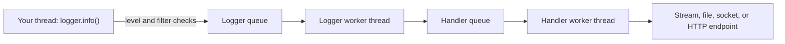
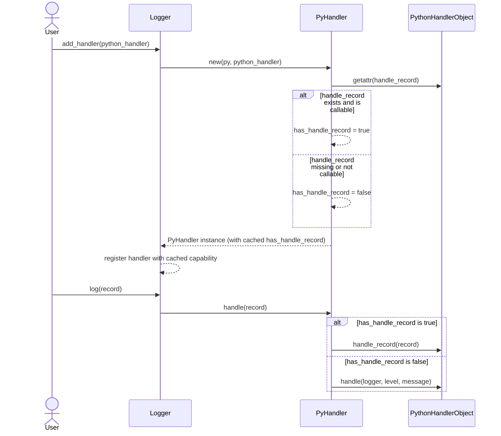

# Femtologging users' guide

Femtologging is a logging library for Python whose loggers hand every record to
Rust worker threads. Your code enqueues a record and carries on; formatting,
file writes, and network calls happen elsewhere.

This guide describes femtologging 0.2.0-beta1. It starts with a single log
message and builds, one idea at a time, towards production configuration and
Rust integration. Read it top to bottom the first time, or jump straight to the
part you need:

- **New to femtologging?** Start with [Get started](#get-started), then
  [Log from your code](#log-from-your-code).
- **Choosing where records go?** See
  [Send records somewhere](#send-records-somewhere).
- **Configuring an application?** See [Configure logging](#configure-logging).
- **Running in production?** See [Run in production](#run-in-production).
- **Coming from the standard library?** Keep
  [Differences from the standard library](#differences-from-the-standard-library)
  open beside you; femtologging looks familiar, but some behaviour differs on
  purpose.
- **Upgrading from 0.1?** Read the
  [0.2.0 migration guide](v0-2-0-migration-guide.md) first.

Every Python example in this guide is run by the test suite exactly as it
appears here, and each one checks its own result with `assert`, so you can see
what should happen as well as how to make it happen.

______________________________________________________________________

## Get started

### Install femtologging

Femtologging needs Python 3.12 or newer. Version 0.2.0-beta1 is a pre-release,
and installers skip pre-releases unless asked, so request it explicitly:

<!-- tested-example: guide-install-pip -->

```bash
python -m pip install "femtologging>=0.2.0b1"
```

Or add it to a [uv](https://docs.astral.sh/uv/) project:

<!-- tested-example: guide-install-uv -->

```bash
uv add "femtologging>=0.2.0b1"
```

The same requirement keeps working once 0.2.0 itself is released.

If no pre-built wheel matches your platform, the installer compiles the Rust
extension from source, which needs the
[Rust toolchain](https://www.rust-lang.org/tools/install). You can also build a
checkout of the repository directly:

<!-- tested-example: guide-install-source -->

```bash
git clone https://github.com/leynos/femtologging.git
cd femtologging
python -m pip install .
```

### Write your first log message

<!-- tested-example: guide-first-message -->

```python
from femtologging import FemtoStreamHandler, get_logger

logger = get_logger("demo.app")
handler = FemtoStreamHandler.stderr()
logger.add_handler(handler)

message = logger.info("hello from femtologging")
assert message == "demo.app [INFO] hello from femtologging"

# Wait for the logger's worker to hand over its records, then stop the
# handler's worker thread.
assert logger.flush_handlers()
handler.close()
```

Running it prints:

<!-- tested-example: guide-first-message-output -->

```text
demo.app [INFO] hello from femtologging
```

Three things happened there:

1. `get_logger("demo.app")` returned the logger registered under that name,
   creating it the first time.
2. `add_handler()` attached a handler that writes to standard error.
3. `logger.info()` checked the level, queued the record, and returned the
   formatted text straight away. A worker thread wrote it out a moment later.

The last two lines matter more than they look. Records are written by
background threads, so a process that exits immediately can leave records in a
queue. `flush_handlers()` waits for the logger's worker, and `close()` waits
for the handler's worker and shuts it down.
[Shut down cleanly](#shut-down-cleanly) covers this in more depth.

### How a record travels

Each logger owns a bounded queue and a worker thread, and so does each built-in
handler. A log call does a little work on your thread, then hands the record
over:

<!-- tested-example: guide-record-flow-diagram -->



_Figure 1: A record crosses two queues before it reaches its destination._

Level checks, filters, and context capture run on your thread, so their results
are decided before the call returns. Formatting and I/O run on the handler's
worker. When a queue is full, femtologging drops the record and counts it
rather than blocking your code;
[Handle back-pressure and dropped records](#handle-back-pressure-and-dropped-records)
explains how to tune that.

______________________________________________________________________

## Log from your code

### Name your loggers

`get_logger(name)` returns the same `FemtoLogger` every time it is called with
the same name. `getLogger(name)` is an alias for code written against the
standard library's `logging.getLogger`.

Dotted names form a hierarchy. Each logger's parent is the name before its last
dot, and the top of every chain is the logger named `root`:

<!-- tested-example: guide-logger-names -->

```python
import femtologging
from femtologging import get_logger

api = get_logger("shop.api")
assert get_logger("shop.api") is api
assert femtologging.getLogger("shop.api") is api
assert api.parent == "shop"
assert get_logger("shop").parent == "root"
assert get_logger("root").parent is None

# Names must not be empty, start or end with a dot, or contain "..".
try:
    get_logger("shop..api")
except ValueError as error:
    assert "consecutive dots" in str(error)
else:
    raise AssertionError("an invalid name should be rejected")
```

### Emit records

Each logger has a method per level, and `log()` takes the level as its first
argument:

<!-- tested-example: guide-emit-records -->

```python
from femtologging import get_logger

logger = get_logger("billing")

assert logger.info("invoice sent") == "billing [INFO] invoice sent"
assert logger.warning("card expiring") == "billing [WARN] card expiring"
assert logger.error("charge failed") == "billing [ERROR] charge failed"
assert logger.critical("ledger offline") == "billing [CRITICAL] ledger offline"
assert logger.log("warning", "level names are case-insensitive") is not None

# Below the logger's level, nothing is queued and the call returns None.
assert logger.debug("not shown") is None
```

A few details are worth knowing early:

- Level names are `TRACE`, `DEBUG`, `INFO`, `WARN` (or `WARNING`), `ERROR`, and
  `CRITICAL`, in any letter case. Warnings are rendered as `WARN`.
- The methods return the record's default rendering
  (`"{logger} [{level}] {message}"`) when the record is accepted, and `None`
  when it is filtered out. The standard library always returns `None`.
- Messages are final strings. There is no `%`-style lazy formatting, so build
  the text first, for example with an f-string.
- Module-level `femtologging.debug()`, `info()`, `warn()`, and `error()` log
  through the root logger, or through the logger named by their `name` keyword
  argument.

### Control levels

Every logger starts at `INFO`. Change it with `set_level()`, read it back from
the `level` property, and ask `isEnabledFor()` before building an expensive
message:

<!-- tested-example: guide-levels -->

```python
from femtologging import get_logger

logger = get_logger("reports")
assert logger.level == "INFO"
assert not logger.isEnabledFor("DEBUG")

logger.set_level("DEBUG")
assert logger.isEnabledFor("DEBUG")
assert logger.debug("row count: 42") == "reports [DEBUG] row count: 42"

# A logger's level is its own: raising the root level does not filter
# records on loggers that have already set theirs.
get_logger("root").set_level("ERROR")
assert logger.debug("still shown") is not None
```

Each logger checks only its own level. Unlike the standard library, a child
logger does not inherit its parent's level, so set levels on the loggers that
emit records, or use [`ConfigBuilder`](#build-a-configuration-in-code) and
`with_default_level()` to give unconfigured loggers a common level.

### Understand propagation

After a logger hands a record to its own handlers, it passes the record up to
its parent, which hands it to _its_ handlers, and so on up to `root`. This is
how a single handler on `root` can serve a whole application. Call
`set_propagate(False)` to stop a logger passing records upwards:

<!-- tested-example: guide-propagation -->

```python
from femtologging import FemtoFileHandler, get_logger

root = get_logger("root")
everything = FemtoFileHandler("everything.log")
root.add_handler(everything)

get_logger("shop.api").info("served by the root handler")

quiet = get_logger("shop.audit")
quiet.set_propagate(False)
assert not quiet.propagate
quiet.info("kept away from root")

assert root.flush_handlers()
everything.close()
with open("everything.log", encoding="utf-8") as log_file:
    assert log_file.read() == "shop.api [INFO] served by the root handler\n"
```

### Record exceptions and call stacks

Pass `exc_info=True` inside an `except` block to attach the active exception
and its traceback, or call `exception()`, which does that for you at `ERROR`
level. Pass `stack_info=True` to attach the current call stack:

<!-- tested-example: guide-exceptions -->

```python
from femtologging import get_logger

logger = get_logger("payments")

try:
    1 / 0
except ZeroDivisionError:
    rendered = logger.exception("refund calculation failed")

assert rendered is not None
assert rendered.startswith("payments [ERROR] refund calculation failed\n")
assert "ZeroDivisionError: division by zero" in rendered

trace = logger.info("checkpoint reached", stack_info=True)
assert trace is not None
assert "Stack (most recent call last):" in trace
```

`exc_info` also accepts an exception instance or a `(type, value, traceback)`
tuple. `False` and `None` capture nothing.

______________________________________________________________________

## Add context to records

Plain messages are fine for people. Machines prefer fields. Femtologging
attaches structured key-value fields to records in two ways: per call, with
`extra`, and for a whole block of code, with `log_context()`.

### Attach fields to one record

`log()` and the level methods accept a keyword-only `extra` mapping:

<!-- tested-example: guide-extra -->

```python
from femtologging import get_logger

logger = get_logger("checkout")
logger.info("order placed", extra={"order_id": 1042, "express": True})

try:
    logger.info("rejected", extra={"items": ["not", "a", "scalar"]})
except TypeError as error:
    assert "context values must be" in str(error)
else:
    raise AssertionError("a list value should be rejected")
```

Keys must be strings and values must be `str`, `int`, `float`, `bool`, or
`None`. An invalid mapping raises an exception on your thread instead of
silently losing data. `exception()` does not accept `extra`; use
`error(..., exc_info=True, extra=...)` when you need both.

### Attach fields to a block of code

`log_context()` is a context manager. Every record created inside the block
carries its fields, and nested blocks override same-named fields from outer
ones. When a field appears in both `log_context()` and `extra`, the `extra`
value wins.

It is built on `contextvars`, so it is safe to hold across `await`: each
`asyncio` task sees only its own fields, even when tasks share a thread. A
child task inherits the fields that were active when it was created.

<!-- tested-example: guide-log-context -->

```python
import asyncio

from femtologging import get_logger, log_context


class FieldCollector:
    """Keep the structured fields of every record the logger delivers."""

    def __init__(self) -> None:
        self.fields: list[dict[str, str]] = []

    def handle(self, logger: str, level: str, message: str) -> None:
        """Accept plain records; unused because handle_record is defined."""

    def handle_record(self, record: dict) -> None:
        self.fields.append(record["metadata"]["key_values"])


logger = get_logger("service")
collector = FieldCollector()
logger.add_handler(collector)


async def handle_request(request_id: int) -> None:
    with log_context(request_id=request_id, user="alice"):
        await asyncio.sleep(0.01)
        logger.info("request accepted", extra={"user": "bob"})


async def main() -> None:
    await asyncio.gather(handle_request(1), handle_request(2))


asyncio.run(main())
assert logger.flush_handlers()

# Field values reach handlers as strings.
assert sorted(fields["request_id"] for fields in collector.fields) == ["1", "2"]
assert {fields["user"] for fields in collector.fields} == {"bob"}
```

Fields from both sources must follow the same rules:

- Keys are non-empty strings that do not clash with standard `LogRecord`
  attributes (`name`, `msg`, `levelname`, `created`, and the rest) or with
  femtologging's own metadata names.
- Values are `str`, `int`, `float`, `bool`, or `None`.
- A record carries at most 64 fields, each key at most 64 UTF-8 bytes, each
  value at most 1,024 UTF-8 bytes, and 16 kibibytes (KiB) of fields in total.

______________________________________________________________________

## Send records somewhere

Handlers decide where records go. Femtologging ships handlers for standard
streams, files, rotating files, sockets, and HTTP endpoints. Each built-in
handler owns a queue and a worker thread. Python objects can act as handlers
too, and existing standard library handlers can be wrapped.

Every built-in handler supports two calls you should know:

- `flush()` waits (one second by default) for the handler's worker to write
  out what it has queued. It returns `True` on success, and `False` when the
  handler is closed or the worker does not answer in time.
- `close()` stops the worker thread after it has written its queue. It is safe
  to call more than once; only the first call does any work.

### Write to standard output or standard error

`FemtoStreamHandler.stderr()` and `FemtoStreamHandler.stdout()` write to the
matching stream. To change the queue capacity, the flush timeout, or the
formatter, use `StreamHandlerBuilder`:

<!-- tested-example: guide-stream-builder -->

```python
from femtologging import StreamHandlerBuilder, get_logger

handler = (
    StreamHandlerBuilder
    .stdout()
    .with_capacity(4096)
    .with_flush_after_ms(250)
    .with_formatter(lambda record: f"{record['level']}: {record['message']}")
    .build()
)
logger = get_logger("cli")
logger.add_handler(handler)
logger.info("ready")

assert logger.flush_handlers()
assert handler.flush()
handler.close()
```

`with_flush_after_ms()` sets how long `flush()` waits for the worker, in
milliseconds.

### Write to a file

<!-- tested-example: guide-file-handler -->

```python
from femtologging import FemtoFileHandler, get_logger

handler = FemtoFileHandler("app.log", capacity=1024, flush_interval=1)
logger = get_logger("app")
logger.add_handler(handler)
logger.info("saved to disk")

assert logger.flush_handlers()
handler.close()
with open("app.log", encoding="utf-8") as log_file:
    assert log_file.read() == "app [INFO] saved to disk\n"
```

`FemtoFileHandler(path, capacity=1024, flush_interval=1, policy="drop")`
appends to `path`, creating it if needed. `flush_interval` counts _records_,
not seconds: the worker flushes the file after that many writes.

`policy` decides what happens when the handler's queue is full:

- `"drop"` (the default) discards the record.
- `"block"` makes the logger's worker wait until there is room.
- `"timeout:N"` waits up to `N` milliseconds, then discards the record.

`FileHandlerBuilder` offers the same settings fluently, through
`with_capacity()`, `with_flush_after_records()`,
`with_overflow_policy(OverflowPolicy.drop() | OverflowPolicy.block() |
OverflowPolicy.timeout(ms))`,
and `with_formatter()`.

### Rotate files by size

`FemtoRotatingFileHandler` rolls the file over before a write would take it past
`max_bytes`. The current file becomes `app.log.1`, older backups shift up to
`backup_count`, and the oldest is removed:

<!-- tested-example: guide-rotating-handler -->

```python
import os

from femtologging import FemtoRotatingFileHandler, HandlerOptions

handler = FemtoRotatingFileHandler(
    "rotating.log",
    options=HandlerOptions(rotation=(64, 2)),
)
assert (handler.max_bytes, handler.backup_count) == (64, 2)

for number in range(10):
    handler.handle("app", "INFO", f"message number {number}")
handler.close()

assert sorted(os.listdir(".")) == ["rotating.log", "rotating.log.1", "rotating.log.2"]
```

`HandlerOptions` also takes `capacity`, `flush_interval`, and `policy`, as
`FemtoFileHandler` does. `rotation=(max_bytes, backup_count)` enables rotation
only when _both_ values are greater than zero; `(0, 0)` disables it, and any
other mix raises `ValueError`. If opening a fresh file after rollover fails,
the handler keeps appending to the existing file instead of losing records.

`RotatingFileHandlerBuilder` offers the same settings, plus `with_max_bytes()`
and `with_backup_count()`.

### Rotate files on a schedule

`FemtoTimedRotatingFileHandler` rotates on a timetable, like the standard
library's `TimedRotatingFileHandler`:

<!-- tested-example: guide-timed-rotating-handler -->

```python
import datetime as dt

from femtologging import FemtoTimedRotatingFileHandler, TimedHandlerOptions

handler = FemtoTimedRotatingFileHandler(
    "nightly.log",
    options=TimedHandlerOptions(
        when="MIDNIGHT",
        backup_count=7,
        utc=True,
        at_time=dt.time(2, 30),
    ),
)
assert (handler.when, handler.interval, handler.backup_count) == ("MIDNIGHT", 1, 7)
assert handler.at_time == "02:30:00"
handler.close()

try:
    TimedHandlerOptions(when="H", at_time=dt.time(2, 30))
except ValueError as error:
    assert "at_time is only supported" in str(error)
else:
    raise AssertionError("at_time should need a daily or weekly schedule")
```

- `when` is one of `S`, `M`, `H`, `D`, `MIDNIGHT`, or `W0` to `W6` (Monday to
  Sunday), and `interval` multiplies it.
- `at_time` is allowed only for `D`, `MIDNIGHT`, and weekday schedules.
- `backup_count=0` keeps every timestamped backup rather than disabling
  rotation.
- `TimedRotatingFileHandlerBuilder` offers the same settings through
  `with_when()`, `with_interval()`, `with_backup_count()`, `with_utc()`, and
  `with_at_time()`.

### Send records over a socket

`SocketHandlerBuilder` builds a `FemtoSocketHandler`, which streams records to
a TCP or Unix-domain socket. Choose a transport with `with_tcp()` or
`with_unix_path()`; building without one raises `HandlerConfigError`.

<!-- tested-example: guide-socket-handler -->

```python
from femtologging import BackoffConfig, FemtoSocketHandler, SocketHandlerBuilder

handler = (
    SocketHandlerBuilder()
    .with_tcp("127.0.0.1", 9020)
    .with_capacity(2048)
    .with_connect_timeout_ms(5000)
    .with_write_timeout_ms(1000)
    .with_tls("logs.example.com", insecure=False)
    .with_backoff(
        BackoffConfig({
            "base_ms": 100,
            "cap_ms": 5000,
            "reset_after_ms": 30000,
            "deadline_ms": 120000,
        })
    )
    .build()
)
assert isinstance(handler, FemtoSocketHandler)
handler.close()
```

- The handler connects in the background and reconnects with exponential
  backoff, so building it never waits for the network.
- Each record is a MessagePack map with the keys `logger`, `level`, `message`,
  `timestamp_ns`, `filename`, `line_number`, `module_path`, `thread_id`,
  `thread_name`, and `key_values`, framed by a 4-byte big-endian length.
- Frames larger than `with_max_frame_size()` (1 MiB by default) are dropped.
- TLS works only over TCP; combining `with_tls()` with `with_unix_path()`
  raises `HandlerConfigError`.

### Send records over HTTP

`HTTPHandlerBuilder` builds a `FemtoHTTPHandler`, which sends one record per
request from its worker thread:

<!-- tested-example: guide-http-handler -->

```python
from femtologging import FemtoHTTPHandler, HTTPHandlerBuilder

handler = (
    HTTPHandlerBuilder()
    .with_endpoint("https://logs.example.com/ingest", method="POST")
    .with_auth({"token": "s3cr3t"})
    .with_headers({"X-Service": "checkout"})
    .with_json_format()
    .with_record_fields(["logger", "level", "message"])
    .build()
)
assert isinstance(handler, FemtoHTTPHandler)
handler.close()
```

- `with_auth({"token": ...})` sends a bearer token, and
  `with_auth({"username": ..., "password": ...})` uses basic authentication.
  The older `with_url()`, `with_method()`, `with_basic_auth()`, and
  `with_bearer_token()` setters still work but are deprecated.
- `with_json_format()` sends JSON bodies, and `with_record_fields()` limits
  which record fields are sent.
- Building without an endpoint raises `HandlerConfigError`; malformed
  arguments, such as a mixed `with_auth()` mapping, raise `ValueError`.
- `close()` waits for the worker for at most the write timeout. A worker still
  retrying against an endpoint that has stopped answering is abandoned with a
  warning instead of blocking your shutdown. It keeps sending the records
  already queued, so those arrive only if the process lives long enough.

### Write your own handler in Python

Any object with a callable `handle(logger, level, message)` method can be a
handler. Define `handle_record(record)` as well to receive the whole record as
a dictionary, including its structured fields:

<!-- tested-example: guide-python-handler -->

```python
import threading

from femtologging import get_logger


class Collector:
    """Keep every record in memory, for tests or diagnostics."""

    def __init__(self) -> None:
        self._lock = threading.Lock()
        self.records: list[dict] = []

    def handle(self, logger: str, level: str, message: str) -> None:
        """Fallback entry point; femtologging prefers handle_record."""

    def handle_record(self, record: dict) -> None:
        with self._lock:
            self.records.append(record)


logger = get_logger("inventory")
collector = Collector()
logger.add_handler(collector)
logger.warning("stock low", extra={"sku": "A-113"})
assert logger.flush_handlers()

record = collector.records[0]
assert (record["logger"], record["level"], record["message"]) == (
    "inventory",
    "WARN",
    "stock low",
)
assert record["metadata"]["key_values"] == {"sku": "A-113"}
assert logger.remove_handler(collector)
```

The record dictionary holds `logger`, `level`, `message`, and `levelno`, a
`metadata` mapping (`timestamp`, `thread_id`, `thread_name`, `key_values`, and
source-location fields that Python callers leave empty), and the structured
`exc_info` and `stack_info` payloads when they were captured.

Python handlers run on the logger's worker thread, inside a copy of the
`contextvars` context that was active when the record was logged. Keep them
fast and thread-safe: a slow handler holds up every record behind it. An
exception raised by a handler is printed to standard error and the next record
is handled as normal.

`add_handler()` accepts built-in and Python handlers alike. `remove_handler()`
returns whether it found the handler, and `clear_handlers()` removes them all.
Records already queued keep the handler list they were queued with.

#### Configure the handler before attaching it

`add_handler()` checks once whether the object has a callable `handle_record`
method and remembers the answer. Adding or removing `handle_record` afterwards
has no effect, so finish configuring a handler before you attach it. Checking
once keeps attribute lookups off the per-record path.

<!-- tested-example: guide-handler-capability-diagram -->



_Figure 2: `add_handler()` detects `handle_record` once, and every later record
uses the cached answer._

### Reuse standard library handlers

The standard library ships handlers that femtologging does not, such as
`SMTPHandler` and `SysLogHandler`. `StdlibHandlerAdapter` wraps any
`logging.Handler` so femtologging can use it, complete with its formatter and
filters:

<!-- tested-example: guide-stdlib-adapter -->

```python
import io
import logging

from femtologging import StdlibHandlerAdapter, get_logger

stream = io.StringIO()
stdlib_handler = logging.StreamHandler(stream)
stdlib_handler.setFormatter(
    logging.Formatter("%(name)s %(levelname)s %(message)s request=%(request_id)s")
)

logger = get_logger("legacy")
logger.add_handler(StdlibHandlerAdapter(stdlib_handler))
logger.info("adapter ready", extra={"request_id": "r-7"})
assert logger.flush_handlers()

assert stream.getvalue() == "legacy INFO adapter ready request=r-7\n"
```

- Levels map to their standard equivalents (`TRACE` becomes level 5, which
  the adapter registers under the name `TRACE`).
- Structured fields become `LogRecord` attributes, so formatters can use
  `%(request_id)s` and filters can read `record.request_id`.
- The wrapped handler runs on the logger's worker thread inside the logging
  caller's `contextvars` context, so filters that read a `ContextVar` see the
  caller's value. Other thread-local state, such as `threading.local`, belongs
  to the worker thread.
- Exceptions arrive as pre-formatted text in `exc_text`; `record.exc_info` does
  not hold a live traceback. `pathname` and `funcName` keep default values,
  because femtologging does not capture them.

______________________________________________________________________

## Shape and filter records

### Format output

The default rendering is `"{logger} [{level}] {message}"`, followed by any
stack trace and exception. To change it, give a handler builder a formatter: a
callable that takes the record dictionary and returns a string, or an object
with a `format(record)` method.

<!-- tested-example: guide-formatter -->

```python
import json

from femtologging import FileHandlerBuilder, get_logger


def json_formatter(record: dict) -> str:
    return json.dumps(
        {
            "logger": record["logger"],
            "level": record["level"],
            "message": record["message"],
            **record["metadata"]["key_values"],
        },
        separators=(",", ":"),
    )


handler = FileHandlerBuilder("app.jsonl").with_formatter(json_formatter).build()
logger = get_logger("api")
logger.add_handler(handler)
logger.info("request served", extra={"status": 200})

assert logger.flush_handlers()
handler.close()
with open("app.jsonl", encoding="utf-8") as log_file:
    line = json.loads(log_file.read())
assert line == {
    "logger": "api",
    "level": "INFO",
    "message": "request served",
    "status": "200",
}
```

Formatters run on the handler's worker thread. The only formatter identifier
that handlers accept today is `"default"`; named formatters registered with
`FormatterBuilder` are stored in configuration but cannot yet be attached to a
handler.

### Filter and enrich records

Filters decide, on your thread, whether a logger accepts a record. Three
builders are available:

- `LevelFilterBuilder().with_max_level(level)` accepts records at or below a
  level, which is handy for sending warnings and errors elsewhere.
- `NameFilterBuilder().with_prefix(prefix)` accepts records whose logger name
  starts with a prefix.
- `PythonCallbackFilterBuilder(callback)` runs your own code. The callback is
  either a callable or an object with a standard-library-style `filter(record)`
  method, such as a `logging.Filter` subclass.

Filters are attached by name through
[`ConfigBuilder`](#build-a-configuration-in-code),
[`RuntimeConfigBuilder`](#change-configuration-at-runtime), or
[`dictConfig`](#use-dictconfig), and run in the order you list them.

A callback filter receives a temporary `logging.LogRecord`. Returning a truthy
value accepts the record, and any new attributes it sets become structured
fields, which makes filters a natural place to attach request metadata:

<!-- tested-example: guide-callback-filter -->

```python
import contextvars
import logging

from femtologging import (
    ConfigBuilder,
    LoggerConfigBuilder,
    PythonCallbackFilterBuilder,
    StdlibHandlerAdapter,
    get_logger,
)

request_id = contextvars.ContextVar("request_id", default="-")


def add_request_id(record: logging.LogRecord) -> bool:
    record.request_id = request_id.get()
    return True


class SkipHealthChecks(logging.Filter):
    def filter(self, record: logging.LogRecord) -> bool:
        return "/healthz" not in record.getMessage()


(
    ConfigBuilder()
    .with_filter("request_id", PythonCallbackFilterBuilder(add_request_id))
    .with_filter("no_health", PythonCallbackFilterBuilder(SkipHealthChecks()))
    .with_logger(
        "web",
        LoggerConfigBuilder().with_filters(["no_health", "request_id"]),
    )
    .with_root_logger(LoggerConfigBuilder())
    .build_and_init()
)

logger = get_logger("web")
request_id.set("req-123")
assert logger.info("GET /healthz") is None
assert logger.info("GET /orders") == "web [INFO] GET /orders"
```

Enrichment follows the same rules as
[structured fields](#attach-fields-to-a-block-of-code). An added attribute that
breaks them, such as a dictionary value, is left off the record with a warning
(see [See femtologging's own warnings](#see-femtologgings-own-warnings)), and
changes to standard attributes such as `record.name` are ignored. The record
itself is still delivered.

______________________________________________________________________

## Configure logging

Femtologging offers four ways to configure loggers, from the quickest to the
most familiar:

- `basicConfig()` attaches one handler to the root logger.
- `ConfigBuilder` describes a whole configuration in Python and applies it in
  one step.
- `RuntimeConfigBuilder` changes a running configuration.
- `dictConfig()` and `fileConfig()` read the standard library's dictionary and
  INI formats, within limits.

The first two are the most capable; the compatibility layers translate into
`ConfigBuilder` and support a subset of their standard library namesakes.

### Start with basicConfig

<!-- tested-example: guide-basic-config -->

```python
from femtologging import BasicConfig, basicConfig, get_logger

basicConfig(level="INFO", filename="basic.log")
get_logger("root").info("configured")

# Replace the handler: force=True clears the root logger's handlers first.
basicConfig(BasicConfig(level="WARNING", filename="basic.log", force=True))
root = get_logger("root")
assert root.level == "WARN"
assert root.flush_handlers()
```

- `basicConfig()` takes `level`, `filename`, `stream` (`sys.stdout` or
  `sys.stderr` only), `force`, and `handlers` (an iterable of handler objects),
  either as keyword arguments or as a `BasicConfig` instance.
- `filename` and `stream` are mutually exclusive, and neither can be combined
  with `handlers`.
- Formatting arguments such as `format` and `datefmt` are not supported yet.
- `BasicConfig` is a slotted dataclass, so a mistyped field name fails at once
  with `AttributeError` instead of being silently ignored.

### Build a configuration in code

`ConfigBuilder` names handlers and filters once, then refers to them by name
from each logger:

<!-- tested-example: guide-config-builder -->

```python
from femtologging import (
    ConfigBuilder,
    FileHandlerBuilder,
    LevelFilterBuilder,
    LoggerConfigBuilder,
    OverflowPolicy,
    StreamHandlerBuilder,
    get_logger,
)

(
    ConfigBuilder()
    .with_default_level("INFO")
    .with_handler("console", StreamHandlerBuilder.stderr())
    .with_handler(
        "audit",
        FileHandlerBuilder("audit.log").with_overflow_policy(OverflowPolicy.block()),
    )
    .with_filter("info_and_below", LevelFilterBuilder().with_max_level("INFO"))
    .with_logger(
        "app.audit",
        LoggerConfigBuilder()
        .with_level("INFO")
        .with_handlers(["audit"])
        .with_filters(["info_and_below"])
        .with_propagate(False),
    )
    .with_root_logger(
        LoggerConfigBuilder().with_level("WARNING").with_handlers(["console"])
    )
    .build_and_init()
)

audit = get_logger("app.audit")
assert audit.info("user signed in") is not None
assert audit.error("too severe for this logger") is None
assert audit.flush_handlers()
```

- `build_and_init()` validates every handler and filter reference and builds
  the whole configuration before touching live loggers. If anything fails, the
  existing configuration stays exactly as it was.
- `with_default_level()` sets the level for loggers that do not set their own.
- `with_disable_existing_loggers(True)` clears handlers and filters from
  loggers created earlier that the new configuration does not mention, while
  keeping their ancestors.
- Builders can be inspected before use: each has an `as_dict()` method.

### Change configuration at runtime

`set_level()` and `set_propagate()` change one logger at any time. For larger
changes, such as swapping handlers on a running service, `RuntimeConfigBuilder`
applies a batch of mutations in one step:

<!-- tested-example: guide-runtime-config -->

```python
from femtologging import (
    LoggerMutationBuilder,
    NameFilterBuilder,
    RuntimeConfigBuilder,
    StreamHandlerBuilder,
    get_logger,
)

worker = get_logger("jobs.worker")
assert worker.level == "INFO"

(
    RuntimeConfigBuilder()
    .with_handler("console", StreamHandlerBuilder.stderr())
    .with_filter("jobs_only", NameFilterBuilder().with_prefix("jobs"))
    .with_logger(
        "jobs.worker",
        LoggerMutationBuilder()
        .with_level("DEBUG")
        .replace_handlers(["console"])
        .replace_filters(["jobs_only"]),
    )
    .apply()
)

assert worker.level == "DEBUG"
assert worker.debug("now visible") is not None
assert worker.flush_handlers()
```

`LoggerMutationBuilder` can `replace_*`, `append_*`, `remove_*`, or `clear_*` a
logger's handlers and filters, and set its level and propagation. Replacing and
clearing work on any logger. Appending and removing edit the handler and filter
IDs recorded by an earlier `ConfigBuilder.build_and_init()`, so a logger that
was never configured that way raises `ValueError` for them. Records already
queued keep the handlers they were queued with.

### Use dictConfig

`dictConfig()` accepts the standard library's dictionary schema, restricted to
what femtologging supports, and applies it through `ConfigBuilder`, so a failed
call leaves the current configuration intact:

<!-- tested-example: guide-dict-config -->

```python
from femtologging import dictConfig, get_logger

dictConfig({
    "version": 1,
    "filters": {"payments_only": {"name": "payments"}},
    "handlers": {
        "file": {"class": "logging.FileHandler", "args": "('payments.log',)"},
    },
    "loggers": {
        "payments": {
            "level": "INFO",
            "handlers": ["file"],
            "filters": ["payments_only"],
            "propagate": False,
        },
    },
    "root": {"level": "WARNING", "handlers": []},
})

payments = get_logger("payments")
assert payments.info("payment captured") is not None
assert payments.flush_handlers()

try:
    dictConfig({"version": 1, "incremental": True, "root": {}})
except ValueError as error:
    assert "incremental configuration is not supported" in str(error)
else:
    raise AssertionError("incremental configuration should be rejected")
```

- **Handlers**: `logging.StreamHandler`, `logging.FileHandler`,
  `logging.handlers.RotatingFileHandler`,
  `logging.handlers.TimedRotatingFileHandler`, and
  `logging.handlers.SocketHandler`, plus their `femtologging.*` equivalents
  (`femtologging.StreamHandler`, `femtologging.FileHandler`, and so on). Stream
  handlers always write to standard error.
- **Arguments**: `args` strings are parsed with `ast.literal_eval`, so they
  must be literals; `"(sys.stdout,)"` is rejected. Socket handlers accept
  `(host, port)` or a single Unix socket path, and keyword arguments mirror the
  builder (`host`, `port`, `unix_path`, `capacity`, `connect_timeout_ms`,
  `write_timeout_ms`, `max_frame_size`, `tls`, `tls_domain`, `tls_insecure`, and
  `backoff_*`).
- **Filters**: each entry has exactly one of `level` or `name`, or uses the
  standard `"()"` factory syntax, for example
  `{"()": "myapp.filters.make_filter", "prefix": "svc"}`. The factory may be a
  dotted path or a callable, and receives the other keys as keyword arguments.
  Mixing `"()"` with `level` or `name` is rejected.
- **Loggers**: a `root` section is required. Loggers accept `level`,
  `handlers`, `filters`, and `propagate`.
- **Not supported** (raising `ValueError`): incremental configuration, handler
  `level`, handler `filters`, and handler formatters.

### Use fileConfig

`fileConfig()` reads standard library INI files and applies them through
`dictConfig()`. Default substitutions such as `%(logdir)s` work, using values
from the file's `[DEFAULT]` section and the `defaults` mapping:

<!-- tested-example: guide-file-config -->

```python
from pathlib import Path

from femtologging import fileConfig, get_logger

Path("logging.ini").write_text(
    """\
[loggers]
keys=root

[handlers]
keys=file

[logger_root]
level=INFO
handlers=file

[handler_file]
class=logging.FileHandler
args=('%(logdir)s/ini.log',)
""",
    encoding="utf-8",
)

fileConfig("logging.ini", defaults={"logdir": "."})
root = get_logger("root")
assert root.info("configured from INI") is not None
assert root.flush_handlers()
```

- The signature is
  `fileConfig(path, defaults=None, disable_existing_loggers=True, encoding=None)`.
- Handler classes need their full name, such as `logging.FileHandler`; the
  standard library's short `FileHandler` form is not resolved.
- `[formatters]` sections, filters, and handler `level` or `formatter` keys
  are not supported and raise `ValueError`.

______________________________________________________________________

## Run in production

### Shut down cleanly

Records are written by background threads, and nothing flushes them for you
when the interpreter exits. Before your process ends:

1. Call `flush_handlers()` on each logger that owns handlers. It waits up to
   two seconds for the logger's worker to pass on its queue, then flushes each
   handler, and returns `True` when all of that succeeded.
2. Call `close()` on each handler you created.

<!-- tested-example: guide-shutdown -->

```python
import atexit

from femtologging import FemtoFileHandler, get_logger

root = get_logger("root")
handler = FemtoFileHandler("service.log")
root.add_handler(handler)


def shut_down_logging() -> None:
    root.flush_handlers()
    handler.close()


atexit.register(shut_down_logging)
get_logger("service").info("started")

# atexit runs this at exit; calling it early shows that it is safe to repeat.
shut_down_logging()
with open("service.log", encoding="utf-8") as log_file:
    assert log_file.read() == "service [INFO] started\n"
```

### Handle back-pressure and dropped records

Queues are bounded so that a slow destination cannot exhaust your memory. Each
logger's queue holds 1,024 records; each handler's capacity defaults to 1,024
and can be changed with `capacity` or `with_capacity()`. When a queue is full:

- the logger drops the record and counts it in `logger.get_dropped()`;
- a file handler applies its overflow policy: `"drop"`, `"block"`, or
  `"timeout:N"`.

Two more counters report records lost for other reasons.
`logger.get_context_dropped()` counts records discarded because Rust scoped
context or Rust key-values failed validation, and
`logger.get_context_capture_failures()` counts records whose `contextvars`
snapshot could not be taken.

If drops are unacceptable, raise handler capacities or use a blocking or
timeout policy. Bear in mind where the waiting happens: a handler attached to a
logger is fed by the logger's worker, so a blocking policy makes that worker
wait. Your thread keeps going until the logger's own queue fills, and from then
on the logger drops records and counts them in `get_dropped()`.

### See femtologging's own warnings

Femtologging reports its internal problems, such as dropped records, handler
errors, and rejected enrichment, through the Rust `log` crate. Those warnings
are discarded unless you route them somewhere. Call `setup_rust_logging()` once
at start-up to deliver them to femtologging loggers named after the Rust module
that raised them, such as `_femtologging_rs.filters.python_callback`. They
propagate to `root` like any other record:

<!-- tested-example: guide-internal-warnings -->

```python
import logging

import femtologging
from femtologging import (
    ConfigBuilder,
    LoggerConfigBuilder,
    PythonCallbackFilterBuilder,
    get_logger,
)

femtologging.setup_rust_logging()


class WarningCollector:
    def __init__(self) -> None:
        self.records: list[tuple[str, str]] = []

    def handle(self, logger: str, level: str, message: str) -> None:
        if level == "WARN":
            self.records.append((logger, message))


def attach_unsupported_field(record: logging.LogRecord) -> bool:
    record.payload = {"nested": "values are not allowed"}
    return True


(
    ConfigBuilder()
    .with_filter("enrich", PythonCallbackFilterBuilder(attach_unsupported_field))
    .with_logger("api", LoggerConfigBuilder().with_filters(["enrich"]))
    .with_root_logger(LoggerConfigBuilder())
    .build_and_init()
)
root = get_logger("root")
warnings = WarningCollector()
root.add_handler(warnings)

get_logger("api").info("request served")
assert root.flush_handlers()
[(source, text)] = warnings.records
assert source == "_femtologging_rs.filters.python_callback"
assert "ignored enrichment" in text
```

### Operational caveats

- `flush_interval` on file handlers counts records. For time-based flushing,
  call `handler.flush()` periodically.
- Socket frames over the size limit are dropped. Truncate or split very large
  messages before logging them.
- `reset_manager()` removes every registered logger. It exists for tests, is
  not thread-safe, and must not run while other threads hold loggers.
- Femtologging's loggers are separate from the standard library's
  `logging` module. Mixing both systems in one process is unsupported; use
  `StdlibHandlerAdapter` to reuse standard handlers instead.

______________________________________________________________________

## Integrate with Rust

This part is for Rust code that runs alongside femtologging, such as the
extension itself or a crate embedded in it. Python-only applications can skip
it.

### Rust and Python context

Rust has its own scoped context, `push_log_context`, which is OS-thread-local.
Its `LogContextGuard` is neither `Send` nor `Sync`, and it removes only its own
frame when dropped. Do not hold a Rust guard across an `.await` in a future
that may move between executor threads.

Python and Rust context fields do not flow into each other. Python logging
calls see only Python `log_context()` fields; Rust macros and records received
through the `log` and `tracing` bridges see only Rust scoped fields active on
their thread, with explicit event fields taking precedence. Pass metadata
explicitly when a request crosses the boundary.

### Bridge the log and tracing crates

`setup_rust_logging()` installs a `log::Log` implementation that routes Rust
`log` records into femtologging loggers named after each record's target.
`setup_rust_tracing()` does the same for `tracing` events and spans. Both are
covered in [the Rust extension notes](rust-extension.md#rust-log-crate-bridge).

### Validate exception schema versions

Structured `exc_info` and `stack_info` payloads carry a `schema_version` field
so their shape can evolve without silent breakage.
`femtologging.EXCEPTION_SCHEMA_VERSION` is the version this release produces.

- Rust consumers accept versions from `MIN_EXCEPTION_SCHEMA_VERSION` to
  `EXCEPTION_SCHEMA_VERSION` inclusive. Within that range, missing optional
  fields take safe defaults.
- A payload from a newer producer may deserialize, but must be validated
  before use.
- The version increases only for breaking changes: new required fields,
  removed or renamed fields, or changed meanings or types. New optional fields
  with safe defaults do not change it.

In Rust, `validate_version()` returns `SchemaVersionError::VersionTooNew` or
`SchemaVersionError::VersionTooOld`, so each case can be handled explicitly:

<!-- tested-example: guide-schema-validation -->

```rust
use _femtologging_rs::{ExceptionPayload, SchemaVersionError, SchemaVersioned};

fn check_payload(json: &str) -> Result<ExceptionPayload, String> {
    let payload: ExceptionPayload =
        serde_json::from_str(json).map_err(|error| error.to_string())?;
    match payload.validate_version() {
        Ok(()) => Ok(payload),
        Err(SchemaVersionError::VersionTooNew { found, max_supported }) => Err(format!(
            "payload schema {found} is newer than supported {max_supported}"
        )),
        Err(SchemaVersionError::VersionTooOld { found, min_supported }) => Err(format!(
            "payload schema {found} is older than minimum {min_supported}"
        )),
    }
}

let current = r#"{"schema_version": 1, "type_name": "ValueError", "message": "bad"}"#;
assert!(check_payload(current).is_ok());

let future = r#"{"schema_version": 999, "type_name": "ValueError", "message": "bad"}"#;
assert_eq!(
    check_payload(future).unwrap_err(),
    "payload schema 999 is newer than supported 1"
);
```

In Python, compare `payload["schema_version"]` with
`femtologging.EXCEPTION_SCHEMA_VERSION` and apply the same policy: reject
payloads that are too old, and reject or carefully degrade those that are too
new.

______________________________________________________________________

## Differences from the standard library

Femtologging keeps the shape of the standard `logging` API, but these
differences are deliberate:

- **Levels are per logger.** A logger never inherits its parent's level; every
  logger starts at `INFO`.
- **Return values.** `log()` and the level methods return the rendered record,
  or `None` when it is filtered out.
- **Messages.** There is no `%`-style lazy formatting and no `LoggerAdapter`.
  Calling-module details (`pathname`, `funcName`, line numbers) are not
  captured for Python callers.
- **Handlers.** Python handlers implement `handle(logger, level, message)`
  and, optionally, `handle_record(record)`, rather than `emit(LogRecord)`, and
  run on worker threads. Wrap standard handlers in `StdlibHandlerAdapter`.
- **Back-pressure.** Queues are bounded and drop records when full, where the
  standard library blocks.
- **Formatting.** `%`, `{}`, and `$` format styles are not implemented;
  attach a formatter callable to a handler instead.
- **Configuration.** `dictConfig()` and `fileConfig()` lack incremental
  updates, handler levels, handler filters, and formatters; `basicConfig()`
  lacks formatting arguments.
- **Separate state.** Femtologging's logger registry is independent of the
  `logging` module's.

______________________________________________________________________

## What is coming

The [roadmap](roadmap.md) tracks planned work, including named formatter
resolution, richer configuration formats, and performance work. Two planned
integrations deserve an early note:

- **Journald** will be a Linux/systemd-specific integration, unavailable on
  Windows and macOS. Elsewhere, ship records to a collector with the stream,
  file, or socket handlers.
- **OpenTelemetry** export is planned on top of the `tracing` bridge.

Both will be explicit opt-ins: enabling a build feature alone will send nothing
until you configure the matching handler. Treat any external sink as
sensitive-data egress and scrub messages and fields before forwarding them.
Until structured export lands, the planned outputs carry message text and basic
metadata (logger name and level), not rich fields or trace correlation.
